<!-- Authors: Nguyen Ho Anh Tuan (23120185). External source: none. -->

# CSC14120 - Panorama Stitching (Nhóm 16)

Đồ án cuối kỳ môn **Lập trình song song (CSC14120)** — Khoa Công nghệ Thông tin, Trường Đại học Khoa học Tự nhiên, ĐHQG-HCM.

Chương trình `stitch` ghép hai ảnh chồng lấn thành một ảnh panorama bằng cùng một pipeline 6 stage và cùng bộ tham số thuật toán trên nhiều phiên bản: bản tuần tự CPU (`V0`), bản CUDA cơ bản (`V1`) và bốn phiên bản tối ưu hóa theo chu trình APOD (`V2`–`V5`). Toàn bộ biên dịch, kiểm chứng đúng đắn, kiểm tra rò rỉ bộ nhớ và đo thời gian chính thức được thực hiện trên **Google Colab GPU Tesla T4 (`sm_75`)**.

## 1. Thành viên Nhóm 16

| Thành viên | MSSV | Stage phụ trách |
|---|---|---|
| Nguyễn Hồ Anh Tuấn | 23120185 | S1 Preprocessing |
| Trần Hữu Kim Thành | 23120166 | S2 Keypoint Detection, S3 Description |
| Lê Thượng Đế | 23120232 | S4 Feature Matching, S5 Homography Estimation |
| Lê Hà Thanh Chương | 23120195 | S6 Warping and Blending |

## 2. Kiến trúc Pipeline

Toàn bộ phiên bản `V0`–`V5` giữ nguyên 6 stage và bộ tham số cấu hình chuẩn (`src/common/v0_config.cpp`). Từ `V1` trở đi, dữ liệu trung gian được giữ hoàn toàn trên bộ nhớ GPU (`Device-resident`): chỉ truyền hai ảnh đầu vào từ Host sang Device (`H2D`) ở đầu pipeline và sao chép ảnh panorama kết quả từ Device về Host (`D2H`) sau `S6`.

```mermaid
flowchart LR
    IN["Ảnh trái (A) & Ảnh phải (B)"] --> H2D["H2D Transfer"]
    H2D --> S1["S1 Preprocessing<br/>Grayscale + Gaussian Blur"]
    S1 --> S2["S2 Keypoint Detection<br/>FAST-9 + 3x3 NMS + Top-K"]
    S2 --> S3["S3 Feature Description<br/>256-bit BRIEF"]
    S3 --> S4["S4 Feature Matching<br/>Brute-force Hamming + Lowe Ratio"]
    S4 --> S5["S5 Homography Estimation<br/>MSAC RANSAC + 4-pt DLT + SVD Refit"]
    S5 --> S6["S6 Warping & Blending<br/>Backward Bilinear + Feather Blending"]
    S6 --> D2H["D2H Transfer"]
    D2H --> OUT["Ảnh Panorama"]
```



## 3. So sánh các phiên bản (V0 – V5)

Tất cả các phiên bản chạy từ cùng một file thực thi `build/stitch` thông qua cờ `--version <0..5>` và cho kết quả nhất quán với `V0` (sai lệch homography trên 6 cặp synthetic đạt RMSE ≤ 0,5 px, Max ≤ 1,0 px; Max RGB error = 0 trên 10/10 cấu hình ảnh thật ghép thành công; 2 cấu hình `challenge/medium` và `challenge/large` trả mã lỗi `NumericalFailure` đồng nhất).

| Phiên bản | Thay đổi chính (APOD) | Thời gian toàn pipeline trên 9 ca chuẩn (T4) | Speedup vs V0 (CPU) | Speedup vs phiên bản trước | Vai trò |
|---|---|---|---:|---:|---|
| **V0** | C/C++ tuần tự thuần (đóng băng làm chuẩn tham chiếu) | 756 – 6.538 ms | 1,00× | — | Baseline CPU |
| **V1** | Basic CUDA, kiến trúc `Device-resident` cho cả 6 stage | 365 – 934 ms | 1,20× – 11,89× | 1,20× – 11,89× | Baseline GPU |
| **V2** | Song song hóa S5: Parallel RANSAC, Inlier Reduction & Refit | 21,51 – 258,52 ms | 8,21× – 70,20× | 1,59× – 43,18× | Keep |
| **V3** | Tối ưu vi kiến trúc S5: warp-shuffle MSAC, shared-memory DLT/SVD, batch scheduling | 21,27 – 108,17 ms | 16,93× – 89,98× (GM 43,10×) | 0,99× – 2,53× (GM 1,85×) | Keep |
| **V4** | Tối ưu S6: Single-pass Canvas Fusion (gộp clear, copy A, gather/blend B) | 21,14 – 107,16 ms | 16,98× – 92,38× (GM 43,02×) | 0,997× – 1,013× (GM 1,009×; S6 1,036×) | **Production Baseline** |
| **V5** | Thử nghiệm 2 CUDA Stream chạy bất đồng bộ H2D + S1–S3 cho 2 ảnh A và B | 20,69 – 102,93 ms | 21,29× – 109,07× | 1,010× – 1,605× (GM 1,027×; pre-S4 1,207×) | **Case Study** |

Ghi chú: Nhóm chọn **V4** làm phiên bản sản phẩm chính thức do V5 chưa vượt ngưỡng cải thiện 5% toàn pipeline theo tiêu chí APOD (tỷ trọng S5/S6 vẫn chiếm ưu thế và 40 SM của Tesla T4 nhanh chóng bão hòa ở S2/S3). Mã nguồn và báo cáo thực nghiệm V5 vẫn được giữ đầy đủ như một nghiên cứu chuyên sâu về giới hạn đa stream trên T4. Chi tiết xem tại [docs/apod-log.md](docs/apod-log.md).

## 4. Yêu cầu phần cứng và môi trường

- **Môi trường kiểm chứng chính thức:** Google Colab với GPU **NVIDIA Tesla T4** (16 GB GDDR6, Compute Capability `7.5`, kiến trúc `sm_75`).
- **Trình biên dịch:** `nvcc` (CUDA Toolkit 12.x / 13.x; đã kiểm chứng trên `nvcc 13.0.88`, driver `580.82.07`) cho bản đầy đủ V0–V5; `g++` (C++11 trở lên) nếu chỉ biên dịch và chạy kiểm thử V0 trên CPU cục bộ.
- **Thư viện:** Chỉ dùng thư viện chuẩn C/C++, `stb_image` / `stb_image_write` (đi kèm trong `src/common/`), CUDA Runtime API, phần cứng intrinsics và NVTX v3. Không sử dụng `Thrust`, `CUB`, `cuBLAS`, `cuSOLVER` hay `NPP`.
- **Python (cho script build, test, benchmark và vẽ biểu đồ):** Python 3.10+ cùng `matplotlib`, `numpy`, `Pillow` (đã cài sẵn trên Colab).
- **Công cụ kiểm chứng & profiling (trên Colab T4):** `compute-sanitizer`, `nsys` (Nsight Systems), `ncu` (Nsight Compute).

## 5. Hướng dẫn cài đặt, biên dịch và chạy

### 5.1 Tải bộ dữ liệu chính thức

Bộ dataset gồm 4 cặp ảnh (24 file ảnh ở 3 độ phân giải `small` 1280×720, `medium` 1920×1080, `large` 3840×2160) kèm `manifest.csv` được lưu trên Google Drive chung. Tải và kiểm tra SHA-256 tự động bằng lệnh:

```bash
python3 scripts/fetch_and_prepare_dataset.py --out dataset
```

### 5.2 Biên dịch

Chạy từ thư mục gốc của repo bằng `scripts/build.py`:

```bash
# Biên dịch chính thức bản đầy đủ V0–V5 bằng nvcc trên Colab Tesla T4
python3 scripts/build.py --compiler nvcc --require-t4

# Xem câu lệnh biên dịch đầy đủ (mặc định: -arch=sm_75 -std=c++11 -O2 --fmad=false)
python3 scripts/build.py --print-command
```

File thực thi sau khi build nằm tại `build/stitch`.

### 5.3 Chạy ghép ảnh mẫu (CLI)

Cú pháp chung:

```bash
./build/stitch <left_image> <right_image> <output_panorama.png> --version <0..5> --runs 5 [--csv <timing.csv>] [--debug]
```

Ví dụ chạy ghép cặp `site1/large` với V0 (CPU), V4 (Production GPU) và V5 (Dual-stream Case Study):

```bash
# V0 — CPU Sequential
./build/stitch dataset/site1/large_left.jpg dataset/site1/large_right.jpg build/pano_v0.png --version 0 --runs 5 --csv build/v0_site1_large.csv

# V4 — Production Baseline GPU (Single-pass Canvas Fusion)
./build/stitch dataset/site1/large_left.jpg dataset/site1/large_right.jpg build/pano_v4.png --version 4 --runs 5 --csv build/v4_site1_large.csv

# V5 — Dual-stream Case Study (hỗ trợ --v5-schedule dual|sequential và --v5-detail-csv)
./build/stitch dataset/site1/large_left.jpg dataset/site1/large_right.jpg build/pano_v5.png --version 5 --v5-schedule dual --runs 5 --csv build/v5_site1_large.csv
```

**Kết quả mong đợi:**
- Chương trình in thông tin GPU, chạy 1 lượt warm-up không bấm giờ, sau đó đo 5 lượt chính thức và xuất ảnh panorama PNG (ví dụ `site1/large` có kích thước canvas `7399×3028`).
- File CSV đầu ra của bản GPU gồm 11 cột chuẩn (`Run_Index,S1_ms,S2_ms,S3_ms,S4_ms,S5_ms,S6_ms,Total_Kernel_ms,H2D_ms,D2H_ms,Total_ms`) kèm 2 dòng tổng hợp `Average` và `Minimum`.
- Trên `challenge/medium` và `challenge/large`, cả V0 và V1–V5 thoát với mã lỗi `NumericalFailure` (ca thất bại dự kiến do hoa văn lặp lan can gây thoái hóa descriptor BRIEF).

### 5.4 Chạy kiểm thử tự động và kiểm tra bộ nhớ

```bash
# Chạy toàn bộ test (14 suite V0, toàn bộ suite GPU V1–V5, 15 suite Python) trên Colab T4
python3 tests/run_tests.py --compiler nvcc --require-t4

# Chỉ chạy kiểm thử Python hoặc V0 trên máy không có GPU
python3 tests/run_tests.py --group python
python3 tests/run_tests.py --compiler g++ --group v0

# Kiểm tra an toàn bộ nhớ (0 lỗi, 0 byte rò rỉ) trên Colab T4
compute-sanitizer --tool memcheck --leak-check full --error-exitcode 99 \
  ./build/stitch dataset/site1/small_left.jpg dataset/site1/small_right.jpg build/memcheck.png --version 4 --runs 1
```

### 5.5 Chạy benchmark đa phiên bản và vẽ biểu đồ

```bash
python3 scripts/run_benchmark.py --stitch build/stitch --dataset dataset --out-dir results/bench --versions 0 1 2 3 4 5 --include-challenge
python3 scripts/plot_benchmark.py --input-dir results/bench --out-dir results/bench/plots
```

## 6. Cấu trúc thư mục

| Đường dẫn | Ý nghĩa |
|---|---|
| `README.md` | Tài liệu tổng quan, hướng dẫn cài đặt, biên dịch, chạy mẫu và kiểm thử |
| `Group16_Final.ipynb` | Notebook báo cáo cuối kỳ đầy đủ 10 mục theo đề bài (chạy `Run all` trên Colab T4) |
| `src/` | Toàn bộ mã nguồn C/C++/CUDA (`common/`, `v0/` đến `v5/`, `main.cu`, `versions.h`) — xem [src/README.md](src/README.md) |
| `tests/` | Bộ kiểm thử tự động C++/CUDA/Python và runner thống nhất (`run_tests.py`) — xem [tests/README.md](tests/README.md) |
| `scripts/` | Công cụ build (`build.py`), tải dataset, benchmark đa phiên bản, profiling Nsight và kiểm chứng CLI — xem [scripts/README.md](scripts/README.md) |
| `experiments/` | Các notebook kiểm chứng, benchmark/profiling theo giai đoạn P5–P10 và lưu trữ giữa kỳ — xem [experiments/README.md](experiments/README.md) |
| `slides/` | Mã nguồn slide thuyết trình LaTeX Beamer (`project.tex`, `performance.tex`) và kịch bản video |
| `docs/` | Kế hoạch, bảng công việc, contract (`interface.md`), dataset, nhật ký APOD, thiết kế 6 stage và báo cáo thực nghiệm — xem [docs/README.md](docs/README.md) |
| `AGENTS_TEMPLATE.md` | Khuôn mẫu quy tắc làm việc dùng chung cho thành viên |

## 7. Tài nguyên và Video thuyết trình

- **Bộ ảnh Dataset cuối kỳ chính thức:** [dataset/ trên Google Drive](https://drive.google.com/drive/folders/1HOvnly1k1QHOsV17qLzSAG4ihszNzCqO?usp=sharing) (chi tiết cấu hình ở [docs/dataset.md](docs/dataset.md)).
- **Kho lưu trữ kết quả thực nghiệm (CSV, biểu đồ, trace `nsys`/`ncu`):** [CSC14120_Group16_Results trên Google Drive](https://drive.google.com/drive/folders/1uJ-4_kgVONvIt5NQIPzdEWTIPrg8Sue1?usp=sharing) (quy ước tại [docs/results-guide.md](docs/results-guide.md)).
- **Video thuyết trình (YouTube Unlisted, 20–30 phút):** *(Sẽ cập nhật đường dẫn chính thức sau khi hoàn tất quay và biên tập ở P12–P13).*
