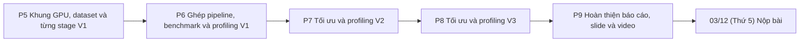
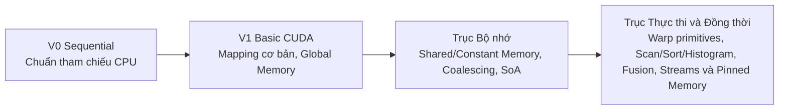

<!-- Authors: Nguyen Ho Anh Tuan (23120185). External source: none. -->

# Kế hoạch thực hiện bài nộp cuối kỳ CSC14120

**Bài nộp:** Final Submission - Parallel CUDA Versions, Report, Slides and Presentation Video.
**Hạn:** 03/12 (Thứ 5). Mọi phần việc phải hoàn thành trước ngày này.

Tài liệu đi kèm:

- [Bảng công việc](task-board.md): danh sách task theo từng giai đoạn, người phụ trách, hạn và trạng thái.
- [Kế hoạch giữa kỳ](archive/midterm-plan.md): các quy ước nền tảng của bản tuần tự V0 ở giai đoạn P0–P4.
- [Interface chung](interface.md) và [Dataset](dataset.md): contract dữ liệu và quy định bộ ảnh thử nghiệm.
- [Đề cuối kỳ](specs/CSC14120_2026_Final%20Project.md): bản chép nguyên văn từ PDF của môn học.

Quy ước ngày: mọi hạn ghi theo dạng `dd/mm (Thứ n)` hoặc `dd/mm (Chủ nhật)` của năm 2026.

## 1. Mục tiêu và sản phẩm nộp

Đến hạn 03/12 (Thứ 5), nhóm hoàn thành trọn bộ sản phẩm theo mục 5 của đề cuối kỳ:

1. **Mã nguồn đa phiên bản (`src/`):** tối thiểu 4 phiên bản của cùng pipeline ghép ảnh (`V0 Sequential`, `V1 Basic CUDA`, và ít nhất 2 phiên bản tối ưu `V2`, `V3`) giữ chung phương pháp và tham số. Mỗi phiên bản sau `V1` chỉ đưa vào đúng một ý tưởng tối ưu chính xuất phát từ điểm nghẽn đo được, đo riêng tác dụng và cho kết quả nhất quán với `V0`. Nhóm chốt mục tiêu hoàn thành chắc chắn 4 phiên bản `V0`–`V3`; chỉ mở thêm `V4` nếu xong `V3` sớm và còn đủ thời gian cho báo cáo, slide và video.
2. **Báo cáo Jupyter Notebook (`Group16_Final.ipynb`) và bản xuất PDF:** chạy `Runtime -> Run all` thành công từ đầu đến cuối trên phiên Google Colab GPU Tesla T4 mới, lưu sẵn toàn bộ output, mọi con số dẫn trong lời văn xuất hiện trực tiếp trong output cell, đủ 10 mục theo mục 5.2 của đề cuối kỳ.
3. **Gói mã nguồn kèm `README.md`:** nêu rõ yêu cầu môi trường và phần cứng, lệnh biên dịch, lệnh chạy mẫu cho các phiên bản, đường dẫn dữ liệu và kết quả mong đợi.
4. **Slide thuyết trình.**
5. **Video thuyết trình dài 20–30 phút:** đăng YouTube ở chế độ Unlisted (đặt link trong cả notebook báo cáo và `README.md`), gồm 4 phần theo đề: tổng quan bài toán và hướng tiếp cận (4–6 phút), live demo chạy code (6–9 phút), kết quả và phân tích hiệu năng (6–9 phút), các tối ưu chính và bài học rút ra (4–6 phút).

## 2. Thành viên và phân vai

| Thành viên | MSSV | Stage phụ trách | Phần việc chung |
|---|---|---|---|
| Nguyễn Hồ Anh Tuấn | 23120185 | S1 Preprocessing | Repo, Drive chung, tái cấu trúc mã nguồn và bộ kiểm thử |
| Trần Hữu Kim Thành | 23120166 | S2 Keypoint detection, S3 Description | Khung kiểm thử GPU, công cụ benchmark và vẽ biểu đồ |
| Lê Thượng Đế | 23120232 | S4 Matching, S5 Homography | Rà soát và chuẩn bị dataset cuối kỳ, công cụ profiling và kiểm chứng synthetic |
| Lê Hà Thanh Chương | 23120195 | S6 Warping and blending | Hạ tầng GPU dùng chung, contract dữ liệu và khung chạy chương trình |

Cột "Phần việc chung" chỉ ghi các mảng việc chung đã có task đến giai đoạn hiện tại (`P5`). Phần việc chung của các giai đoạn sau được cập nhật cuốn chiếu khi lập kế hoạch chi tiết cho giai đoạn đó.

Phân công theo phiên bản pipeline (mục tiêu tối ưu cụ thể của `V2`, `V3` chỉ được chốt sau khi có kết quả timing và profiling thực tế của phiên bản liền trước):

| Thành viên | V0 Sequential | V1 Basic CUDA | V2, V3 Optimized |
|---|---|---|---|
| Tuấn | S1 (đóng băng) | Kernel S1 | Tối ưu S1 hoặc cấp pipeline nếu profiling chỉ ra điểm nghẽn |
| Thành | S2, S3 (đóng băng) | Kernel S2, S3 | Tối ưu S2, S3 theo kết quả profiling |
| Đế | S4, S5 (đóng băng) | Kernel S4, S5 | Tối ưu S4, S5 theo kết quả profiling |
| Chương | S6 (đóng băng) | Kernel S6 | Tối ưu S6 theo kết quả profiling |

Ở các giai đoạn tối ưu `V2`, `V3`, khi chỉ một hoặc hai stage là điểm nghẽn chính cần sửa kernel, các thành viên còn lại đảm nhận song song việc thu thập bằng chứng profiling (`nsys`, `ncu`), hoàn thiện kiểm thử tự động và viết cuốn chiếu báo cáo, slide của phiên bản vừa hoàn tất.

## 3. Các giai đoạn

Kế hoạch cuối kỳ tiếp tục lập **cuốn chiếu** nối tiếp từ `P5`: chỉ giai đoạn đang mở có danh sách task và hạn chi tiết trong [bảng công việc](task-board.md); các giai đoạn tiếp theo chỉ ghi tên và được lập chi tiết ngay sau khi giai đoạn trước hoàn thành cùng số đo thực tế. Mốc cố định duy nhất là **03/12 (Thứ 5)**.

| Mã | Giai đoạn | Kế hoạch chi tiết |
|---|---|---|
| P5 | Khung GPU, dataset và từng stage V1 | Đã lập, kết thúc 02/11 (Thứ 2) |
| P6 | Ghép pipeline, benchmark và profiling V1 | Đã lập, kết thúc 08/11 (Chủ nhật) |
| P7 | Tối ưu và profiling V2 | Lập sau khi hoàn thành P6 |
| P8 | Tối ưu và profiling V3 | Lập sau khi hoàn thành P7 |
| P9 | Hoàn thiện báo cáo, slide và video | Lập sau khi hoàn thành P8, hoàn tất trước 03/12 (Thứ 5) |

Kết quả cần có khi kết thúc `P5`:

- hạ tầng GPU dùng chung (`src/common/cuda_utils.cuh`), contract workspace `Device-resident` cho `V1` và định dạng CSV mở rộng trong `src/main.cu` đã merge vào `main`;
- khung chạy nhóm test GPU trong `tests/` và các công cụ benchmark đa phiên bản, thu thập profiling theo batch trong `scripts/` đã sẵn sàng và đạt test trên Colab T4;
- cả 6 stage của `V1` (`S1`–`S6`) đã được cài đặt, định nghĩa ngưỡng kiểm chứng so với `V0` trong `docs/stages/` và đạt bài test đối chiếu trên Colab T4;
- phương án chọn lại cặp chuẩn `site2` và cặp khó `challenge` đã được đánh giá, thống nhất trong Nhóm và cập nhật lên bộ `dataset/` trên Drive chung.

Kết quả cần có khi kết thúc `P6`:

- pipeline `v1_pipeline` hoàn chỉnh trong `src/main.cu` chạy trọn vẹn 6 stage trên GPU, đạt toàn bộ bài test đối chiếu và `compute-sanitizer` 0 lỗi;
- bộ benchmark chính thức V0 vs V1 trên dataset cuối kỳ ở cả 3 độ phân giải hoàn thành trên Colab T4, xuất đủ CSV 11 cột và biểu đồ speedup;
- báo cáo profiling Nsight (`nsys` timeline, `ncu` kernel metrics) chỉ rõ bottleneck của V1, phân tích ca thất bại `challenge` và đề xuất phương án tối ưu cho V2 (P7).

## 4. Đóng băng V0 và hướng xử lý dataset cuối kỳ

1. **Giữ đóng băng thuật toán và tham số `V0`:** bản `V0` trong `src/v0/` đã được kiểm chứng hình học trên bộ cặp synthetic ở giữa kỳ và giữ vai trò chuẩn tham chiếu cố định cho toàn bộ `V1`, `V2`, `V3`. Không tự ý thay đổi phương pháp hay tham số của `V0`.
2. **Rà soát và chọn lại cặp ảnh trong `dataset/`:** ở bộ ảnh giữa kỳ, cặp chuẩn `site2` bị bóng ma rõ do lỗi parallax của cảnh nhiều độ sâu, trong khi cặp khó `challenge` lại có đối tượng chuyển động nằm ngoài vùng chồng lấn nên ghép thành công và chưa tạo được ca thất bại rõ ràng cho phần phân tích lỗi (failure analysis). Việc khắc phục được thực hiện ở tầng dữ liệu thông qua đánh giá lại kho ảnh, đề xuất cặp thay thế kèm lập luận kỹ thuật và báo lại cho cả Nhóm để cùng quyết định trước khi chạy `scripts/prepare_dataset.py` cập nhật `dataset/`.
3. **Tách phụ thuộc để không chặn tiến độ cài đặt GPU:** trong thời gian rà soát và chốt bộ `dataset/` mới, việc phát triển và kiểm thử đơn vị các kernel `V1` vẫn dùng bộ `dataset/` giữa kỳ và các cặp ảnh `synthetic`. Bộ `dataset/` cuối kỳ chỉ cần chốt xong trước lượt chạy benchmark và profiling chính thức của `V1` ở `P6`, để mọi số đo dẫn dắt sang `V2`, `V3` đều nằm trên bộ ảnh chính thức cuối kỳ.

## 5. Kiến trúc mã nguồn, contract GPU và làm việc song song

### 5.1 Tổ chức thư mục `src/` và `tests/`

Mã nguồn trong `src/` được chia theo phần nền tảng dùng chung và từng phiên bản cài đặt (quy ước chi tiết tại [`src/README.md`](../src/README.md)):

- `src/main.cu`, `src/versions.h`: điểm vào CLI, điều phối phiên bản `--version <0|1|2|...>`, vòng lặp warm-up, đo thời gian và xuất CSV.
- `src/common/`: contract dữ liệu `common.h`, tiện ích CUDA `cuda_utils.cuh`, cấu hình tham số chuẩn, các module hỗ trợ dùng chung và thư viện `stb`.
- `src/v0/`: bản tuần tự C/C++ đóng băng của 6 stage và `v0_pipeline.*`.
- `src/v1/`: cài đặt `V1 Basic CUDA` cho đủ 6 stage, contract workspace GPU và `v1_pipeline.*`.
- `src/v2/`, `src/v3/`: mỗi thư mục chỉ chứa `v<k>_pipeline.*` và những file stage/module thực sự thay đổi ở phiên bản đó; các stage không đổi gọi lại trực tiếp hàm của phiên bản trước, không nhân bản mã nguồn.

Bộ kiểm thử trong `tests/` được quản lý qua runner thống nhất `tests/run_tests.py` (chi tiết tại [`tests/README.md`](../tests/README.md)), tách riêng `tests/v0/`, `tests/gpu/`, `tests/python/`, `tests/support/` và `tests/tools/`. Trong `tests/gpu/`, mỗi stage đặt bài test ở file riêng của người phụ trách để làm song song không đụng file và tái sử dụng từ `V1` sang `V3`.

### 5.2 Kiến trúc bộ nhớ `Device-resident` ngay từ `V1`

Ngay từ `V1`, dữ liệu trung gian giữa `S1 -> S2 -> S3 -> S4 -> S5 -> S6` được giữ xuyên suốt trên bộ nhớ Device:

- chỉ truyền hai ảnh đầu vào từ Host sang Device (`H2D`) ở đầu pipeline và truyền ảnh panorama kết quả từ Device về Host (`D2H`) ở cuối `S6`;
- chỉ đọc về Host vài biến đếm hoặc kích thước nhỏ (như số lượng phần tử hợp lệ hoặc kích thước khung canvas) khi cần điều phối cấu hình launch kernel hoặc cấp phát bộ nhớ đầu ra;
- contract hàm và workspace GPU giữa 6 stage được chốt thống nhất từ `V1` và giữ ổn định qua `V2`, `V3`.

### 5.3 Cắt phụ thuộc dây chuyền và quyền tự quyết của chủ stage

1. **Phát triển độc lập bằng dữ liệu `V0`:** các thành viên phụ trách stage sau (`S2`–`S6`) dùng trực tiếp đầu ra trung gian của `V0` làm đầu vào chuẩn để viết và kiểm thử kernel GPU của mình ngay từ đầu giai đoạn, không chờ các stage GPU phía trước hoàn tất.
2. **Quyền tự quyết kỹ thuật và chuẩn nhất quán với `V0`:** người phụ trách stage tự quyết định cách chia thread/warp/block, bố cục bộ nhớ nội bộ và cách cài đặt bên trong stage của mình, miễn bảo đảm hai điều kiện biên:
   - giữ nguyên phương pháp và tham số thuật toán đã chốt ở `V0` (nếu thật sự cần thay đổi thì phải báo lại cho cả Nhóm để cùng quyết định và cập nhật đồng bộ từ `V0`);
   - không ép khớp từng bit máy móc trên các phép tính số thực dấu phẩy động nếu làm mất tính song song tự nhiên của GPU, nhưng phải định nghĩa rõ ngưỡng sai số chấp nhận được so với `V0` (`verification tolerance`), kiểm chứng tự động bằng test và ghi rõ quyết định kỹ thuật vào `docs/stages/<stage>.md` để cả Nhóm nắm khi tích hợp và bảo vệ vấn đáp.

## 6. Quy định viết code và chính sách thư viện CUDA

1. **Biên dịch và môi trường chuẩn:** biên dịch bằng `nvcc -arch=sm_75` (thông qua `scripts/build.py`), kiểm chứng và đo chính thức trên Google Colab với GPU Tesla T4.
2. **Đường dẫn `#include`:** dùng một gốc `-Isrc` duy nhất cho chương trình chính (thêm `-Itests` khi build test); mọi lệnh `#include` nội bộ ghi rõ thư mục con tính từ `src/` (ví dụ `#include "common/common.h"`, `#include "v0/v0_pipeline.h"`).
3. **Chính sách thư viện trong `src/`:**
   - chỉ sử dụng thư viện chuẩn C/C++, `stb` có sẵn trong `src/common/`, **CUDA Runtime API cơ bản** và **các intrinsics phần cứng** (`__popc`, `__shfl_*`, phép toán atomic...); kèm nhãn NVTX khi phục vụ profiling;
   - không sử dụng các thư viện thuật toán đóng gói sẵn như `Thrust`, `CUB`, `cuBLAS`, `cuSOLVER`, `NPP` (trừ khi báo lại cho cả Nhóm để cùng quyết định hỏi trước và được giảng viên cho phép rõ ràng);
   - giữ `src/v0/` hoàn toàn tuần tự theo đúng quy định của [kế hoạch giữa kỳ](archive/midterm-plan.md).
4. **Comment đầu file, tính tái lập và mã hóa:** mọi file code, test, script tạo mới hoặc chỉnh sửa (trừ file `.ipynb`) phải có comment `Authors:` và `External source:` (hoặc `Adapted from:` kèm `Changes:`) ở đầu file, ghi nguồn vào `docs/report/references.md` nếu tham khảo bên ngoài; cố định seed cho mọi yếu tố ngẫu nhiên; đặt log chi tiết và ảnh debug dưới cờ `--debug` ngoài vùng đo thời gian; lưu UTF-8 không BOM, xuống dòng LF.

## 7. Đo thời gian, profiling hai tầng và định hướng tối ưu

### 7.1 Cơ chế đo và profiling hai tầng

Để vừa tuân thủ quy tắc đo tại mục 4.2 của đề cuối kỳ, vừa chỉ ra chính xác điểm nghẽn bên trong từng stage mà không làm sai lệch cơ chế thực thi bất đồng bộ trên GPU, việc đo được tách làm hai tầng:

1. **Tầng 1 - Luồng benchmark chính thức (`--runs 5` mặc định sau 1 lượt warm-up không bấm giờ):**
   - dùng `std::chrono::high_resolution_clock` cho `V0` và `cudaEvent_t` (`cudaEventRecord`, `cudaEventElapsedTime`) cho các phiên bản GPU;
   - đo ở ranh giới 6 stage cùng `total_kernel_ms`, `host_to_device_ms`, `device_to_host_ms` và `end_to_end_ms` (loại trừ thời gian đọc/ghi ảnh trên đĩa); không đặt lệnh đồng bộ thừa giữa các bước con bên trong một stage;
   - báo cáo cả trung bình và giá trị nhỏ nhất của 5 lượt chạy, tính `speedup` so với `V0` và so với phiên bản liền trước trên cả 3 độ phân giải (`small`, `medium`, `large`);
   - mọi phiên bản đặt trong cùng một bảng so sánh phải được đo trên cùng một GPU trong cùng một phiên Colab T4, kèm in tên GPU và cấu hình chạy.
2. **Tầng 2 - Micro-profiling tìm điểm nghẽn:**
   - bọc nhãn `NVTX` (`nvtxRangePushA` / `nvtxRangePop`) quanh các bước con và khối hàm bên trong từng stage để chạy **Nsight Systems (`nsys`)** và **Nsight Compute (`ncu`)** trên Colab T4, thu thập timeline và chỉ số phần cứng (memory throughput, occupancy, warp stall reasons...) làm bằng chứng bắt buộc cho mỗi phiên bản tối ưu;
   - khi cần bảng phân rã thời gian từng bước con để vẽ biểu đồ chẩn đoán, thực hiện ở lượt chạy hoặc cờ chẩn đoán tách biệt khỏi 5 lượt benchmark chính thức.

### 7.2 Hai trục phân tích cải tiến gắn với học phần CSC14120

Các phiên bản tối ưu sau `V1` được phân tích và dẫn dắt theo hai trục kiến thức của môn học:

- **Trục Bộ nhớ (`Memory Optimization`):** giải quyết điểm nghẽn băng thông và đọc lặp Global Memory (tiling bằng Shared Memory, đưa trọng số lọc và bảng mẫu vào Constant Memory, tối ưu truy cập gộp `coalesced` / bố cục `SoA`, tận dụng bộ nhớ đệm chỉ đọc khi lấy mẫu ảnh).
- **Trục Thực thi và Đồng thời (`Execution & Concurrency Optimization`):** giải quyết điểm nghẽn thực thi của warp/kernel và luồng pipeline (giảm `warp divergence`, `warp-shuffle` reduction, gộp kernel, áp dụng các mẫu song song `Scan`, `Histogram`, `Radix Sort`, hoặc kết hợp `Pinned Memory` với nhiều `CUDA Streams` cho hai nhánh ảnh A và B ở `H2D + S1–S3`).

Hai trục trên là khung lý thuyết để phân loại điểm nghẽn trong báo cáo và vấn đáp; nhóm không ấn định cứng thứ tự hay ép kỹ thuật trước khi có số đo timing và profiling thực tế của phiên bản liền trước trên Colab T4.

### 7.3 Quản trị hạn mức GPU Colab T4

Các thành viên viết code và kiểm tra cú pháp, biên dịch sơ bộ trên máy cá nhân trước. Khi lên Colab T4, chỉ chạy kiểm thử, benchmark và thu thập profiling (`nsys`, `ncu`) theo batch ngắn bằng các script chuẩn hóa trong `scripts/` và `tests/`, lưu kết quả rồi ngắt kết nối runtime ngay (`Disconnect and delete runtime`) để bảo toàn hạn mức GPU của nhóm cho các đợt đo tổng hợp cuối kỳ.

## 8. Quy định Git và cuốn chiếu sản phẩm nộp

### 8.1 Nhánh làm việc và pull request

| Loại thay đổi | Cách làm |
|---|---|
| Code và test của stage mình | Mỗi giai đoạn dùng một nhánh `<tên thành viên>/p<số giai đoạn>`, ví dụ `thanh/p5`, `de/p5`. Mở pull request về `main` khi hoàn tất và đã chạy test đạt trên Colab T4 |
| File dùng chung (`src/main.cu`, `src/versions.h`, `src/common/*`, contract workspace dùng chung, `docs/interface.md`, runner và script hạ tầng dùng chung) | Mỗi thay đổi đi qua một pull request riêng, gọn, từ nhánh `<tên thành viên>/shared-<mô tả ngắn>`, ví dụ `chuong/shared-gpu-contract` |
| Tài liệu trong phạm vi của mình (`docs/task-board.md`, `docs/dataset.md`, `docs/stages/<stage>.md`, `docs/report/<mục của mình>.md`) | Commit thẳng lên `main` |

Commit message viết bằng tiếng Anh theo chuẩn Conventional Commits, dùng mã task làm scope (ví dụ `feat(p5-t10): implement basic CUDA Hamming matcher`). Không commit dữ liệu ảnh, file build, output thực nghiệm, bí mật/token, PDF hoặc notebook còn lưu output (trừ bản đóng gói nộp bài).

### 8.2 Cuốn chiếu báo cáo, slide và video thuyết trình

1. **Báo cáo notebook:** tiếp tục soạn tách rời từng mục dưới dạng các file Markdown riêng trong `docs/report/` ngay sau khi đóng mỗi phiên bản (`V1`, `V2`, `V3`), chỉ ghép tập trung vào `Group16_Final.ipynb` ở giai đoạn cuối để tránh xung đột trên file `.ipynb`.
2. **Slide và video 20–30 phút:**
   - phần tổng quan bài toán, kiến trúc pipeline và phương pháp (4–6 phút đầu) có thể chốt kịch bản và dựng slide sớm;
   - ngay khi xong mỗi phiên bản `V1`, `V2`, `V3`, người phụ trách lưu lại ảnh/bảng profiling Nsight, dựng luôn các slide phân tích kỹ thuật (điểm nghẽn, ý tưởng, cài đặt, kết quả) và ghi chú kịch bản thuyết trình cho phần đó;
   - phần live demo chạy code (6–9 phút) và bảng tổng hợp `speedup` toàn bộ phiên bản thực hiện tập trung ở giai đoạn cuối trên cùng một phiên Colab T4 với bộ `dataset/` chính thức, tránh phải quay lại nhiều lần.

## 9. Tiêu chí hoàn thành một task và checklist nộp bài

Một task cài đặt code/kernel hoặc công cụ được coi là xong khi:

1. mã nguồn đặt đúng thư mục theo quy ước, có đầy đủ comment tác giả và nguồn tham khảo;
2. biên dịch sạch bằng `nvcc -arch=sm_75` trên Colab T4 (không vi phạm chính sách thư viện ở mục 6);
3. đạt toàn bộ bài test đơn vị và test đối chiếu với `V0` theo ngưỡng `verification tolerance` đã định nghĩa trên Colab T4;
4. tài liệu liên quan (`docs/stages/<stage>.md`, `docs/interface.md` hoặc hướng dẫn sử dụng công cụ) đã được cập nhật khớp với code;
5. đã mở pull request kèm log build/test trên Colab T4 và merge vào `main`; trạng thái trên [bảng công việc](task-board.md) chuyển sang `Xong`.

Checklist tổng thể trước hạn 03/12 (Thứ 5):

- [ ] Có tối thiểu 4 phiên bản (`V0`, `V1`, `V2`, `V3`) chạy từ cùng một chương trình `stitch --version <k>`, dùng chung phương pháp và tham số, cho kết quả nhất quán với `V0`.
- [ ] Mỗi phiên bản tối ưu (`V2`, `V3`...) có đầy đủ 5 phần trong báo cáo (Bottleneck kèm bằng chứng profiling `nsys`/`ncu`, Idea, Implementation, Result, Analysis).
- [ ] Mọi bảng so sánh thời gian và `speedup` giữa các phiên bản trên cả 3 độ phân giải được đo trong cùng một phiên Colab T4, báo cáo đủ thời gian từng stage, `total_kernel_ms`, `H2D`, `D2H` và `end_to_end_ms`.
- [ ] Mục Results gallery có đầy đủ ảnh ghép các cặp chuẩn và ít nhất một ca thất bại kèm giải thích nguyên nhân.
- [ ] `Group16_Final.ipynb` chạy `Runtime -> Run all` từ đầu đến cuối không lỗi trên phiên Colab T4 mới, lưu sẵn toàn bộ output, khớp từng con số trong lời văn, có bản xuất PDF, đầy đủ tài liệu tham khảo và các khai báo bắt buộc theo mục 6 của đề cuối kỳ.
- [ ] Gói mã nguồn có `README.md` đầy đủ thông tin thiết lập, biên dịch, chạy mẫu, yêu cầu phần cứng, kết quả mong đợi và link video YouTube Unlisted (20–30 phút); mọi link Drive và YouTube mở được ở chế độ ẩn danh.
