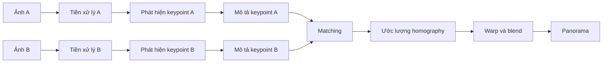
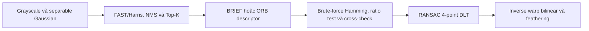
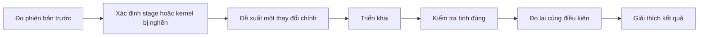

# Giải thích chi tiết đồ án cuối kỳ CSC14120 - Parallel Programming

**Tài liệu nguồn:** `CSC14120_2026_Final Project.pdf` (9 trang).

Mục đích của bản Markdown này là diễn giải lại yêu cầu bằng tiếng Việt, giải thích các khái niệm kỹ thuật và cung cấp ví dụ dễ hiểu. Khi có khác biệt, PDF gốc vẫn là đặc tả chính thức.

## 1. Đồ án yêu cầu làm gì?

Nhóm phải xây dựng một chương trình **ghép hai ảnh chồng lấn thành một ảnh panorama**. Cùng một pipeline phải có ít nhất bốn phiên bản:

- **V0 - Sequential:** C/C++ đơn luồng, dùng làm chuẩn đúng và chuẩn thời gian.
- **V1 - Basic CUDA:** toàn bộ các giai đoạn chạy trên GPU bằng các kernel tương đối trực tiếp.
- **V2 và V3 - Optimized:** ít nhất hai phiên bản tối ưu, mỗi phiên bản có một ý tưởng tối ưu chính và có số đo chứng minh tác dụng.

Đây không chỉ là bài tập “chuyển code CPU sang GPU”. Nhóm được đánh giá đồng thời ở ba mặt:

1. **Đúng:** panorama phải căn chỉnh hợp lý, các phiên bản GPU phải nhất quán với V0.
2. **Nhanh:** đo đúng thời gian, chỉ ra nút thắt và chứng minh speedup.
3. **Hiểu:** giải thích được thuật toán, cách ánh xạ lên CUDA, nguyên nhân nhanh/chậm và các giới hạn trong buổi bảo vệ.

### Ví dụ trực quan

Giả sử ảnh A chụp nửa trái của một tòa nhà và ảnh B chụp nửa phải, hai ảnh trùng nhau khoảng 40%. Chương trình phải:

1. tìm các điểm đặc trưng như góc cửa sổ trong từng ảnh;
2. xác định góc cửa sổ nào ở A tương ứng với góc nào ở B;
3. tìm phép biến đổi đưa các điểm của B về đúng vị trí trong A;
4. biến dạng ảnh B theo phép biến đổi đó;
5. trộn vùng chồng lấn để tạo một ảnh rộng liền mạch.

## 2. Dataset nhóm phải tự chuẩn bị

Mỗi nhóm tự chụp ảnh tại các địa điểm không trùng với nhóm khác, nhằm tạo bộ dữ liệu riêng.

| Hạng mục | Mức tối thiểu | Vai trò |
|---|---:|---|
| Địa điểm | 3 địa điểm khác nhau | Tạo sự đa dạng; gợi ý gồm một nơi trong nhà, một nơi ngoài trời và một nơi nhóm tự chọn |
| Cặp ảnh chuẩn | 1 cặp/địa điểm, tổng cộng 3 cặp | Benchmark chính và bộ sưu tập kết quả |
| Cặp ảnh khó | 1 cặp | Phân tích thất bại: ít texture, họa tiết lặp, người di chuyển, cảnh đêm... |

Mỗi cặp ảnh phải được cắt về tỷ lệ **16:9** và tạo ba kích thước từ **cùng một cảnh**:

| Mức | Độ phân giải | Mục đích |
|---|---:|---|
| Small | 1280 x 720 | Phát triển và gỡ lỗi nhanh |
| Medium | 1920 x 1080 | Benchmark chính trong bảng speedup |
| Large | 3840 x 2160 | Thể hiện khả năng mở rộng của GPU; V0 có thể mất vài giây |

Việc dùng cùng một cảnh ở ba độ phân giải rất quan trọng. Nếu ảnh small và ảnh large là hai cảnh khác nhau, chênh lệch thời gian có thể do số keypoint, độ khó matching hoặc nội dung ảnh, chứ không chỉ do kích thước bài toán.

### Cách chụp đúng

- Đứng yên tại một vị trí và **xoay máy ảnh**, không bước ngang giữa hai lần chụp.
- Hai ảnh nên chồng lấn khoảng **30-50%**.

Lý do không nên bước ngang là hiện tượng **parallax**. Vật gần và vật xa dịch chuyển tương đối khác nhau khi tâm máy ảnh đổi chỗ. Một homography duy nhất thường chỉ mô tả tốt cảnh phẳng hoặc ảnh chụp bằng phép quay quanh gần cùng tâm camera; nó không thể đồng thời căn đúng mọi độ sâu khi parallax lớn.

Ví dụ: nếu một cột đèn ở gần che một cửa sổ ở xa trong ảnh A nhưng không còn che cửa sổ đó trong ảnh B, không có một phép biến đổi phẳng duy nhất nào làm cả cột đèn lẫn cửa sổ trùng hoàn toàn.

## 3. Pipeline ghép ảnh gồm sáu giai đoạn

Ba giai đoạn đầu chạy độc lập trên từng ảnh. Vì vậy A và B có thể được xử lý song song, chẳng hạn bằng hai CUDA stream. Ba giai đoạn sau cần dữ liệu từ cả hai ảnh.



### 3.1 Tiền xử lý: grayscale và làm mượt

**Mục tiêu:** đưa ảnh về dạng thuận tiện cho phát hiện đặc trưng và giảm nhiễu.

Chuyển RGB sang grayscale thường dùng một tổng có trọng số, ví dụ:

```text
gray = 0.299 R + 0.587 G + 0.114 B
```

Gaussian blur thay giá trị một pixel bằng trung bình có trọng số của các pixel lân cận. Nhờ đó nhiễu cao tần bớt gây ra “góc giả”.

**Cách song song hóa:** mỗi thread xử lý một pixel. Với blur 2D có kernel kích thước `k x k`, mỗi pixel cần gần `k^2` phép lấy mẫu. Nếu Gaussian là separable, ta lọc ngang rồi lọc dọc, giảm công việc xuống khoảng `2k` mẫu/pixel.

Ví dụ với kernel 7 x 7:

- lọc 2D trực tiếp: 49 hệ số/pixel;
- lọc separable: 7 theo ngang + 7 theo dọc = 14 hệ số/pixel.

Tối ưu thường gặp là nạp một tile ảnh vào shared memory. Tile phải có thêm vùng **halo** xung quanh để các thread ở mép block vẫn đọc được láng giềng. Việc này giảm số lần nhiều thread đọc lặp cùng pixel từ global memory.

### 3.2 Phát hiện keypoint

**Keypoint** là điểm dễ nhận ra và có thể tìm lại trong ảnh kia, thường là góc hoặc vùng có biến thiên mạnh theo nhiều hướng.

Các lựa chọn được PDF gợi ý:

- **Harris / Shi-Tomasi:** dựa trên độ biến thiên cường độ theo hai chiều; phù hợp để tìm góc.
- **FAST:** kiểm tra nhanh một vòng pixel quanh điểm ứng viên; thường nhanh hơn.
- **DoG kiểu SIFT:** tìm cực trị qua không gian tỷ lệ; bền hơn khi ảnh thay đổi kích thước nhưng nặng hơn.
- **Non-maximum suppression (NMS):** chỉ giữ cực đại cục bộ, tránh nhiều keypoint chen quanh cùng một góc.
- **Top-K:** chỉ giữ K điểm có score tốt nhất.

Phần tính score theo từng pixel khá tự nhiên trên GPU. Khó khăn nằm ở đầu ra có kích thước thay đổi: không biết trước sẽ có bao nhiêu điểm vượt ngưỡng.

Hai cách gom keypoint:

1. **Atomic counter:** thread tìm thấy điểm hợp lệ dùng `atomicAdd` để lấy vị trí ghi. Dễ cài nhưng có thể tranh chấp khi quá nhiều điểm.
2. **Prefix sum/scan:** tạo mảng cờ 0/1, scan để tính vị trí ghi duy nhất cho từng điểm. Phức tạp hơn nhưng thường mở rộng tốt hơn.

Top-K còn cần sort hoặc selection. Nhóm phải tính cả chi phí này, không chỉ thời gian tính corner score.

### 3.3 Tạo descriptor

Descriptor là “chữ ký” mô tả vùng quanh một keypoint để so sánh giữa hai ảnh.

- **BRIEF:** thực hiện nhiều phép so sánh cặp pixel, đóng gói kết quả thành chuỗi bit.
- **ORB:** thường kết hợp FAST với BRIEF có điều chỉnh hướng quay.
- **SIFT-like:** histogram hướng gradient, thường là vector float; bền vững hơn nhưng tính toán và lưu trữ nặng hơn.

Ví dụ descriptor nhị phân 256 bit chỉ chiếm 32 byte. Khoảng cách Hamming giữa hai descriptor bằng số bit khác nhau:

```text
distance = popcount(descA XOR descB)
```

Trên CUDA, toán tử `__popc` đếm số bit 1 trong một word 32 bit rất nhanh. Đây là lý do ORB/BRIEF thường hợp với GPU hơn descriptor float dài.

### 3.4 Matching

Với mỗi descriptor ở ảnh A, tìm descriptor giống nhất ở ảnh B.

Nếu A có `N` keypoint và B có `M` keypoint, brute force cần kiểm tra khoảng `N x M` cặp. Đây là bài toán all-pairs tương tự nhân ma trận ở cấu trúc truy cập dữ liệu.

Các phép lọc match quan trọng:

- **Nearest neighbor:** chọn khoảng cách nhỏ nhất.
- **Lowe's ratio test:** nếu khoảng cách tốt nhất là `d1` và tốt nhì là `d2`, chỉ nhận match khi `d1/d2` đủ nhỏ, ví dụ dưới một ngưỡng đã chọn. Một match rõ ràng phải tốt hơn đáng kể so với lựa chọn thứ hai.
- **Cross-check:** A chọn B và B cũng phải chọn lại A.

Ví dụ `d1 = 18`, `d2 = 20` cho tỷ lệ 0.90: hai lựa chọn gần như nhau, match mơ hồ. Nếu `d1 = 18`, `d2 = 40`, tỷ lệ 0.45: match đáng tin hơn.

Tối ưu GPU có thể chia B thành tile trong shared memory để nhiều thread xử lý các keypoint A tái sử dụng cùng dữ liệu B. Cần bố trí dữ liệu coalesced và tránh giữ quá nhiều giá trị trung gian trong register.

### 3.5 Ước lượng homography bằng RANSAC

Homography là ma trận chiếu 3 x 3, biến điểm `(x, y)` của ảnh B sang ảnh A. Trong tọa độ đồng nhất:

```text
[u']   [h00 h01 h02] [x]
[v'] = [h10 h11 h12] [y]
[w']   [h20 h21 h22] [1]

u = u' / w'
v = v' / w'
```

Ma trận có chín phần tử nhưng chỉ xác định tới một hệ số tỷ lệ, nên có tám bậc tự do. Một cặp điểm cho hai phương trình; vì thế cần ít nhất bốn cặp điểm không suy biến để ước lượng bằng DLT.

Matching chắc chắn có outlier. **RANSAC** xử lý bằng cách lặp:

1. chọn ngẫu nhiên bốn match;
2. tính một homography giả thuyết;
3. chiếu tất cả điểm và đếm inlier có sai số dưới ngưỡng;
4. giữ giả thuyết có nhiều inlier nhất;
5. tùy chọn: ước lượng lại từ toàn bộ inlier.

Ví dụ có 500 match nhưng 120 match sai. Least squares dùng cả 500 điểm có thể bị kéo lệch mạnh. RANSAC có cơ hội chọn bốn điểm đều đúng, rồi nhận ra phần lớn 380 match đúng đồng thuận với cùng một phép biến đổi.

Trên GPU, các giả thuyết độc lập nên có thể giao một thread, warp hoặc block cho mỗi giả thuyết. Việc đếm inlier là một phép reduction. Cần cẩn thận với sinh số ngẫu nhiên, trường hợp bốn điểm gần thẳng hàng, chia cho số rất nhỏ và cách chọn kết quả tốt nhất.

### 3.6 Warping và blending

**Inverse warping** thường dễ tránh lỗ hơn forward warping. Với mỗi pixel đầu ra, ta dùng nghịch đảo homography để hỏi: pixel này lấy dữ liệu từ tọa độ nào của ảnh nguồn?

- **Nearest neighbor:** lấy pixel gần nhất; nhanh nhưng dễ răng cưa.
- **Bilinear:** nội suy bốn pixel lân cận; mượt hơn.

Đây là mẫu **gather**: mỗi thread tạo một pixel đầu ra và đọc vị trí có thể không liên tiếp trong ảnh nguồn. Texture memory có thể hữu ích nhờ cache không gian, xử lý biên và nội suy bilinear phần cứng.

Sau warp, vùng chồng lấn cần được trộn:

- **Overwrite:** ảnh sau ghi đè ảnh trước; nhanh nhưng đường nối dễ thấy.
- **Feathering:** trọng số thay đổi dần theo khoảng cách tới biên; cân bằng tốt giữa độ đơn giản và chất lượng.
- **Multi-band blending:** trộn ở nhiều dải tần bằng pyramid; che đường nối và chênh sáng tốt hơn nhưng tốn thêm nhiều bước.

Ví dụ feathering với trọng số `alpha`:

```text
output = alpha * A + (1 - alpha) * B
```

Nếu `alpha` chuyển dần từ 1 sang 0 qua vùng overlap, đường nối bớt gắt. Tuy nhiên, blending không sửa được lỗi hình học lớn; hai cạnh cửa sổ lệch nhau vẫn tạo bóng đôi.

## 4. Chọn phương pháp: phải cân bằng chất lượng và khả năng song song

PDF không bắt buộc một tổ hợp thuật toán duy nhất. Nhóm được chọn phương pháp nếu:

- lựa chọn hợp lý;
- panorama đủ tốt;
- có thể triển khai hiệu quả;
- giải thích được cả chất lượng lẫn hiệu năng trong notebook và bảo vệ.

Một pipeline khả thi, chỉ mang tính minh họa:



Pipeline này hợp GPU vì phần lớn công việc là theo pixel/keypoint/match và descriptor nhị phân hỗ trợ `__popc`. Đổi sang SIFT-like có thể tăng độ bền với thay đổi tỷ lệ nhưng làm tăng độ phức tạp, lượng dữ liệu float và công việc histogram.

Điểm quan trọng là **cùng phương pháp và cùng tham số ở mọi phiên bản**. Không được làm V0 bằng SIFT chất lượng cao rồi làm V1 bằng ORB nhanh hơn và gọi chênh lệch đó là CUDA speedup. Khi thuật toán khác nhau, so sánh không còn công bằng.

Các tham số nên được công bố rõ, ví dụ:

- sigma và kích thước Gaussian kernel;
- ngưỡng corner/FAST;
- số keypoint tối đa;
- số bit descriptor;
- ngưỡng ratio test;
- có/không cross-check;
- số vòng RANSAC và ngưỡng reprojection error;
- kiểu nội suy và blending.

## 5. Bốn phiên bản tối thiểu và logic tối ưu

| Phiên bản | Ý nghĩa | Yêu cầu chính |
|---|---|---|
| V0 | Chuẩn tuần tự | C/C++ đơn luồng, làm chuẩn đúng và chuẩn speedup |
| V1 | CUDA cơ bản | Mọi stage chạy trên GPU bằng kernel trực tiếp; dùng global memory vẫn được |
| V2 | Tối ưu 1 | Kế thừa V1 và thêm một ý tưởng chính có động cơ từ số đo |
| V3 | Tối ưu 2 | Kế thừa V2 và thêm một ý tưởng chính khác có thể đo riêng |

Có thể làm V4 trở lên, nhưng tối thiểu phải có hai phiên bản tối ưu sau V1.

### Mỗi tối ưu phải xuất phát từ bottleneck

Quy trình hợp lý:



Ví dụ:

- V1 cho thấy blur chiếm 38% kernel time và memory throughput thấp.
- V2 chuyển convolution 2D thành separable, dùng constant memory cho hệ số.
- V2 giảm blur từ 4.0 ms xuống 1.3 ms nhưng end-to-end chỉ giảm từ 12 ms xuống 9.3 ms vì matching trở thành bottleneck.
- V3 tile descriptor B vào shared memory và dùng `__popc`, nhắm đúng bottleneck mới.

Một tối ưu chậm hơn vẫn được chấp nhận nếu phân tích trung thực. Ví dụ shared-memory tile quá lớn làm occupancy giảm; overhead đồng bộ cao hơn lượng global read tiết kiệm được. Đây là kết quả kỹ thuật có giá trị nếu có số đo.

### Các hướng tối ưu được đề xuất

**Bộ nhớ**

- shared-memory tiling có halo;
- constant memory cho hệ số lọc hoặc mẫu descriptor;
- texture memory cho warping;
- structure of arrays để truy cập coalesced.

**Tính toán**

- separable convolution;
- `__popc` cho Hamming distance;
- fast math, loop unrolling;
- cho mỗi thread làm nhiều hơn một phần tử nếu giúp giảm overhead.

**Mẫu song song**

- warp shuffle cho reduction;
- prefix-sum compaction thay atomic toàn cục;
- top-K song song;
- một warp cho mỗi giả thuyết RANSAC.

**Cấp pipeline**

- fusion grayscale + blur;
- giữ dữ liệu trên GPU giữa các stage;
- pinned host memory;
- hai CUDA stream để xử lý A và B đồng thời.

**Cấp thuật toán**

- dừng sớm trong matching/RANSAC;
- image pyramid;
- giảm độ chính xác số nếu chất lượng cho phép.

## 6. Giao diện chương trình bắt buộc

Một chương trình duy nhất xử lý mọi phiên bản bằng cờ dòng lệnh:

```bash
./stitch <left_image> <right_image> <output_image> --version <0|1|2|...> [--runs N]
```

- Đầu vào: hai ảnh RGB.
- Ảnh B được warp sang hệ tọa độ của ảnh A.
- Đầu ra: ảnh panorama.
- `--runs N`: chạy pipeline N lần và báo trung bình; mặc định là 5.

Ví dụ:

```bash
./stitch dataset/site1/medium_left.jpg dataset/site1/medium_right.jpg \
  results/site1_v2.jpg --version 2 --runs 10
```

Nên kiểm tra lỗi đầu vào rõ ràng: thiếu file, version không tồn tại, số lần chạy không dương, ảnh không đọc được, không đủ match hoặc homography suy biến.

## 7. Đo hiệu năng đúng cách

Nếu cách đo sai, speedup không có ý nghĩa dù số liệu trông đẹp.

### 7.1 CPU V0

Dùng `std::chrono::high_resolution_clock`. Chỉ đo phần pipeline được quy định; thời gian đọc và lưu file không tính vào benchmark.

### 7.2 GPU

Dùng CUDA event quanh từng stage:

```cpp
cudaEventRecord(start, stream);
kernel<<<grid, block, 0, stream>>>(...);
cudaEventRecord(stop, stream);
cudaEventSynchronize(stop);
cudaEventElapsedTime(&ms, start, stop);
```

Không dùng CPU timer bao quanh kernel launch rồi dừng ngay, vì kernel launch bất đồng bộ. Khi đó CPU chỉ đo thời gian “xếp lệnh”, không phải thời gian kernel hoàn thành.

### 7.3 Quy trình benchmark

1. Chạy warm-up một lần để loại CUDA context creation và overhead lần chạy đầu.
2. Chạy ít nhất 5 lần có đo.
3. Báo trung bình; nếu dao động lớn, báo thêm minimum.
4. Báo thời gian từng stage.
5. Báo tổng kernel time.
6. Báo host-device transfer time.
7. Báo end-to-end time, không gồm đọc/ghi đĩa.
8. Tính speedup so với V0 và so với phiên bản ngay trước, ở cả ba độ phân giải.
9. Đo các phiên bản trong cùng GPU và cùng phiên Colab; in tên GPU với kết quả.

Hai công thức cần dùng:

```text
speedup_vs_V0 = time_V0 / time_current
speedup_vs_previous = time_previous / time_current
```

Ví dụ V0 = 800 ms, V1 = 100 ms, V2 = 80 ms:

- speedup V2 so với V0 = `800 / 80 = 10x`;
- speedup V2 so với V1 = `100 / 80 = 1.25x`.

Không nên chỉ viết “giảm 20 ms”; tỷ lệ tương đối cho biết mức cải thiện trong bối cảnh phiên bản trước.

### 7.4 Profiling evidence

Mỗi phiên bản tối ưu phải có bằng chứng tạo động cơ, chẳng hạn:

- timeline Nsight Systems cho thấy stage nào chiếm ưu thế hoặc có khoảng trống giữa kernel;
- Nsight Compute: memory throughput, occupancy, warp stall reasons của kernel chính;
- ảnh chụp màn hình hoặc tóm tắt văn bản đều được chấp nhận.

Không nên chọn tối ưu ngẫu nhiên rồi chỉ giải thích sau. Notebook phải thể hiện chuỗi lập luận “bằng chứng -> giả thuyết -> thay đổi -> kết quả”.

## 8. Kiểm chứng tính đúng và chất lượng

PDF yêu cầu mọi phiên bản cho kết quả nhất quán với V0. Vì floating-point và thứ tự reduction có thể khác, “nhất quán” không nhất thiết là từng byte ảnh giống hệt nhau; nhóm nên xác định metric/tolerance có lý và giải thích.

Các kiểm tra hữu ích:

- số keypoint/match/inlier có nằm trong phạm vi mong đợi;
- homography không chứa NaN/Inf và không gần suy biến;
- reprojection error của inlier;
- chênh lệch homography hoặc ảnh so với V0 trong tolerance;
- panorama không bị lỗ lớn, crop sai hoặc kích thước bất thường;
- xem trực quan alignment ở các đường thẳng, góc nhà, cửa sổ;
- dùng cùng dữ liệu, tham số và seed RANSAC nếu cần tái lập.

Một panorama nhìn đẹp không tự động chứng minh thuật toán đúng, và một metric nhỏ cũng không thay thế kiểm tra trực quan. Cần cả hai.

## 9. Sản phẩm phải nộp

### 9.1 Báo cáo đồ án

- Jupyter Notebook `.ipynb` theo cấu trúc bắt buộc.
- Chạy được trên Google Colab.
- Xuất thêm PDF để lưu trữ.

### 9.2 Gói mã nguồn

Bao gồm `.cpp`, `.cu`, `.h` và các file cần thiết. `README.md` phải có:

- cách cài dependency, phiên bản CUDA và thư viện;
- lệnh biên dịch;
- hướng dẫn chạy kèm ví dụ;
- yêu cầu phần cứng, model GPU và bộ nhớ;
- đầu ra mong đợi.

### 9.3 Slide thuyết trình

Slide nên phản ánh cùng câu chuyện với notebook: bài toán, pipeline, V0, bottleneck, từng tối ưu, kết quả và bài học.

### 9.4 Video 20-30 phút

Video tải lên YouTube ở chế độ **Unlisted**, đặt liên kết trong notebook và README, không tải video trực tiếp lên Moodle.

Phân bổ nội dung được yêu cầu:

- tổng quan và phương pháp: 4-6 phút;
- demo trực tiếp: 6-9 phút;
- kết quả và phân tích hiệu năng: 6-9 phút;
- tối ưu chính và bài học: 4-6 phút.

## 10. Cấu trúc notebook bắt buộc

Notebook phải chạy từ đầu đến cuối bằng **Runtime -> Run all** trên một phiên Colab GPU mới, ngoài thao tác tải dataset nếu cần. Mọi output cell phải được lưu trong file nộp. Mọi con số trong phần viết phải xuất phát từ output cell.

### 10.1 Thông tin nhóm

Tên, MSSV và bảng đóng góp theo stage/phiên bản. Bảng nên cụ thể hơn “cùng làm”, ví dụ ai phụ trách detector, matching, benchmark, notebook, validation.

### 10.2 Giới thiệu

Diễn đạt bài toán bằng lời của nhóm và cho thấy pipeline tổng thể.

### 10.3 Phương pháp đã chọn

Nêu phương pháp ở cả sáu stage, lý do chất lượng và hiệu quả song song, cùng toàn bộ tham số quan trọng.

### 10.4 V0 Sequential

Trình bày thiết kế, mã quan trọng, panorama, thời gian từng stage và stage chi phối.

### 10.5 V1 Basic CUDA

Giải thích ánh xạ thread/block cho từng stage, mã quan trọng, kiểm chứng với V0, timing và speedup.

### 10.6 Mỗi V2, V3, ...

Mỗi phiên bản phải có cùng năm mục:

1. **Bottleneck:** số đo/profiling của phiên bản trước.
2. **Idea:** tối ưu và lý do kỳ vọng hiệu quả.
3. **Implementation:** thay đổi mã chính.
4. **Result:** kiểm chứng với V0, timing, speedup so với V0 và phiên bản trước.
5. **Analysis:** kết quả có đúng kỳ vọng không và vì sao.

### 10.7 So sánh cuối

Bảng và biểu đồ speedup của mọi phiên bản ở mọi độ phân giải; thêm breakdown từng stage của phiên bản tốt nhất.

### 10.8 Results gallery

Panorama từ các cặp ảnh được cung cấp và ảnh của nhóm. Bắt buộc có ít nhất một trường hợp thất bại và giải thích nguyên nhân.

### 10.9 Kết luận

Bài học, giới hạn và hướng sẽ thử tiếp. Nên phân biệt giới hạn thuật toán (parallax, vật chuyển động) với giới hạn triển khai (atomic contention, occupancy thấp, transfer overhead).

### 10.10 Tài liệu tham khảo

Liệt kê paper, tutorial, code đã tham khảo và khai báo công cụ AI.

## 11. Tính tái lập: notebook “Run all” thực sự nghĩa là gì?

Một notebook tái lập nên tự động:

1. hiển thị thông tin GPU, CUDA và compiler;
2. cài dependency với phiên bản rõ ràng;
3. lấy hoặc nhận `src/` và dataset theo đường dẫn đã mô tả;
4. biên dịch chương trình;
5. chạy test/cặp synthetic nếu có;
6. chạy V0, V1, V2, V3 trên dữ liệu;
7. parse kết quả thành bảng;
8. tạo biểu đồ và hiển thị panorama;
9. không phụ thuộc vào biến còn sót từ lần chạy thủ công trước.

Các lỗi tái lập thường gặp:

- notebook chứa một bản code, gói `src/` lại chứa bản khác;
- đường dẫn tuyệt đối tới Drive của một thành viên;
- cell phải chạy sai thứ tự;
- output số trong phần Markdown được gõ tay, không sinh từ kết quả;
- thiếu seed hoặc thông tin GPU;
- quên lưu output trước khi nộp.

## 12. Liêm chính học thuật

- Được đọc paper, tutorial và mã nguồn mở.
- Mã hoặc ý tưởng bên ngoài phải được trích dẫn tại chỗ dùng trong notebook và trong References.
- Thảo luận ý tưởng giữa các nhóm được phép; chia sẻ code giữa các nhóm không được phép.
- Được dùng ChatGPT, Claude, Copilot... để học, gỡ lỗi và giải thích, nhưng phải khai báo công cụ và mục đích.
- Nhóm chỉ nên nộp mã AI tạo ra nếu mọi thành viên có thể giải thích và sửa nó trong bảo vệ.
- Toàn bộ timing và ảnh phải do mã đã nộp tạo ra. Bịa hoặc chỉnh sửa kết quả dẫn đến điểm 0 cho đồ án.

Một mẫu khai báo AI ngắn gọn có thể nêu: tên công cụ, dùng cho việc gì, phần nào của mã/tài liệu chịu ảnh hưởng, và cách nhóm đã kiểm tra kết quả. Không nên tuyên bố “không dùng AI” nếu thực tế có dùng.

## 13. Ví dụ hoàn chỉnh về câu chuyện tối ưu

Các số sau chỉ để minh họa cách trình bày, **không phải kết quả được phép sao chép**.

| Phiên bản | Thay đổi chính | End-to-end medium | Speedup so V0 | Speedup so bản trước |
|---|---|---:|---:|---:|
| V0 | C++ tuần tự | 1200 ms | 1.00x | - |
| V1 | Kernel CUDA trực tiếp | 180 ms | 6.67x | 6.67x |
| V2 | Separable blur + shared-memory tile | 140 ms | 8.57x | 1.29x |
| V3 | Tiled Hamming matching + `__popc` | 75 ms | 16.00x | 1.87x |

Phân tích tốt không dừng ở bảng:

- V1 nhanh hơn lớn vì hàng triệu pixel/match được xử lý song song.
- V2 cải thiện vừa phải vì blur chỉ là một phần tổng thời gian; sau tối ưu, matching chi phối.
- V3 nhắm đúng matching, tăng tái sử dụng descriptor B và giảm chi phí đếm bit.
- Nếu large có speedup cao hơn small, một lý do có thể là GPU được lấp đầy tốt hơn và overhead cố định ít chi phối hơn.
- Nếu end-to-end speedup thấp hơn kernel speedup, transfer và phần tuần tự đang giới hạn hệ thống.

## 14. Checklist thực hiện và bàn giao

### Dataset

- [ ] Đăng ký 3 địa điểm không trùng nhóm khác.
- [ ] Có 3 cặp chuẩn và 1 cặp khó.
- [ ] Chụp bằng xoay camera, overlap 30-50%.
- [ ] Mỗi cặp có small, medium, large từ cùng cảnh và tỷ lệ 16:9.

### Thuật toán và phiên bản

- [ ] Chốt cùng phương pháp/tham số cho V0-V3.
- [ ] V0 là C/C++ đơn luồng và chạy đủ sáu stage.
- [ ] V1 đưa mọi stage lên GPU.
- [ ] Có ít nhất V2 và V3, mỗi bản một tối ưu chính.
- [ ] Mọi bản được kiểm chứng nhất quán với V0.

### Benchmark

- [ ] Có warm-up.
- [ ] Ít nhất 5 lần đo.
- [ ] CUDA event cho GPU, `std::chrono` cho V0.
- [ ] Có per-stage, kernel total, transfer và end-to-end.
- [ ] Không tính đọc/ghi đĩa.
- [ ] Có speedup so V0 và so bản trước ở ba độ phân giải.
- [ ] Cùng GPU, cùng Colab session; in tên GPU.
- [ ] Mỗi tối ưu có profiling evidence.

### Báo cáo và nộp bài

- [ ] Notebook chạy `Run all` trên phiên Colab GPU mới.
- [ ] Mọi output cell đã lưu.
- [ ] Mọi con số trong bài sinh từ output cell.
- [ ] Có bảng đóng góp, gallery và ít nhất một failure case.
- [ ] README đủ setup/build/run/hardware/expected output.
- [ ] Có slide, PDF báo cáo và video YouTube Unlisted 20-30 phút.
- [ ] Có trích dẫn nguồn và khai báo AI.
- [ ] Không có timing hoặc ảnh được bịa/chỉnh sửa.

## 15. Tài liệu đọc thêm được PDF gợi ý

- Nayar, *Image Stitching*, monograph FPCV-2-4 (2025).
- Richard Szeliski, *Computer Vision: Algorithms and Applications*, bản thứ hai (2022), đặc biệt các chương về feature detection/matching, image alignment và stitching.

Hai nguồn này giúp hiểu nền tảng thị giác máy tính. Khi triển khai CUDA, nhóm vẫn cần tự phân tích pattern truy cập bộ nhớ, mức song song và bottleneck cụ thể của mã mình.
