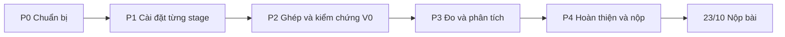

# Kế hoạch thực hiện bài nộp giữa kỳ CSC14120

**Bài nộp:** Midterm Submission - Proposal and Sequential Version (10% điểm đồ án).
**Hạn:** 23/10/2026 (T6). Mọi phần việc phải hoàn thành trước ngày này.

Tài liệu đi kèm:

- [Bảng công việc](task-board.md): danh sách task theo giai đoạn, người phụ trách, hạn và trạng thái.
- [Dataset](dataset.md): quy định chụp ảnh và chuẩn bị dữ liệu.
- [Đề giữa kỳ](specs/CSC14120_2026_Final%20Project_MidTerm.md) và [đề cuối kỳ](specs/CSC14120_2026_Final%20Project.md): bản chép nguyên văn từ PDF của môn học.

Quy ước ngày: mọi hạn ghi theo dạng `dd/mm (thứ)` của năm 2026.

## 1. Mục tiêu và sản phẩm

Đến 23/10, nhóm nộp `Group16_Midterm.zip` gồm:

1. `Group16_Midterm.ipynb`: báo cáo Colab đã lưu toàn bộ output, đủ các mục 3.1-3.7 của đề.
2. `src/`: toàn bộ mã nguồn build được chương trình `stitch`, trong đó V0 chạy đủ 6 stage, đơn luồng.
3. Link dataset trong notebook.

Tiêu chí hoàn thành:

- V0 cho sai số homography trên cặp synthetic đạt ngưỡng nhóm đã chốt và tạo panorama chấp nhận được cho cả 3 site.
- Có bảng timing theo từng stage ở 3 độ phân giải, xác định được hot stage, tính `p` và `1/(1-p)`.
- Có kế hoạch GPU cho từng stage dựa trên số đo.
- Notebook chạy `Runtime -> Run all` thành công trên một phiên Colab T4 mới, mọi con số trong lời văn đều xuất hiện trong output.

## 2. Thành viên và phân vai

| Thành viên | MSSV | Stage phụ trách | Phần việc chung |
|---|---|---|---|
| Tuấn | | S1 Preprocessing | |
| Thành | | S2 Keypoint detection, S3 Description | |
| Đế | | S4 Matching, S5 Homography | |
| Chương | | S6 Warping and blending | |

Phân công dự kiến đến cuối kỳ (dùng cho mục 3.1 của notebook). V2 và V3 chỉ được chốt sau khi có profiling V1.

| Thành viên | V0 | V1 Basic CUDA | V2, V3 |
|---|---|---|---|
| Tuấn | S1 | Kernel S1 | Tối ưu S1 nếu profiling cho thấy S1 là bottleneck |
| Thành | S2, S3 | Kernel S2, S3 (gồm thu gom keypoint và top-K) | Tối ưu S2/S3 theo profiling |
| Đế | S4, S5 | Kernel S4, S5 | Tối ưu S4/S5 theo profiling |
| Chương | S6 | Kernel S6 | Tối ưu S6 theo profiling |

Ngoài các task đã giao trong P0, các phần việc chung như duy trì khung chương trình, quản lý bộ nhớ host-device, timing bằng CUDA event và tối ưu cấp pipeline hiện **chưa phân công**.

## 3. Các giai đoạn

Kế hoạch được lập **cuốn chiếu**: chỉ giai đoạn hiện tại có nội dung và hạn chi tiết. Khi một giai đoạn hoàn thành, nhóm lập kế hoạch chi tiết cho giai đoạn kế tiếp và cập nhật vào [bảng công việc](task-board.md). Nội dung và hạn có thể điều chỉnh liên tục cho phù hợp với tiến độ thực tế. Mốc cố định duy nhất là 23/10.



| Mã | Giai đoạn | Kế hoạch chi tiết |
|---|---|---|
| P0 | Chuẩn bị | Đã lập, kết thúc 06/10 (T3) |
| P1 | Cài đặt từng stage | Lập khi P0 hoàn thành |
| P2 | Ghép và kiểm chứng V0 | Lập khi P1 hoàn thành |
| P3 | Đo và phân tích | Lập khi P2 hoàn thành |
| P4 | Hoàn thiện và nộp | Lập khi P3 hoàn thành |

Kết quả cần có khi kết thúc P0:

- repo GitHub và Google Drive chung đã sẵn sàng, khung `src/` đã được tạo và build được;
- ảnh gốc đã chụp và được kiểm tra;
- mỗi người phụ trách đã chọn sơ bộ phương pháp và xác định đầu vào/đầu ra cho stage của mình;
- interface chung đã chốt.

## 4. Làm song song, không chờ nhau

Sau khi chốt interface, mỗi stage có thể được phát triển và kiểm thử độc lập bằng **dữ liệu đầu vào tự tạo**, không cần đợi stage trước hoàn thành. Vì vậy trong mỗi giai đoạn ai cũng có việc để làm, chỉ khác nhau về khối lượng.

Mỗi người phụ trách tự quyết định cách kiểm thử stage của mình. Bảng dưới chỉ là **ví dụ minh họa** cho ý tưởng dùng dữ liệu tự tạo, không phải yêu cầu.

| Stage | Ví dụ đầu vào tự tạo | Ví dụ cách kiểm tra |
|---|---|---|
| S1 Preprocessing | Ảnh thật đọc bằng stb | Xuất ảnh kết quả ra file để xem |
| S2 Detection | Ảnh hình học đơn giản biết trước vị trí góc | Keypoint nằm gần các góc đã biết |
| S3 Description | Keypoint đặt sẵn trên ảnh thật | Cùng một điểm trên cùng ảnh cho cùng descriptor |
| S4 Matching | Descriptor tự sinh có đáp án biết trước | Tỷ lệ ghép đúng |
| S5 Homography | Tập điểm sinh từ một homography biết trước | Homography ước lượng gần homography đã biết |
| S6 Warp + blend | Ảnh thật với một homography tự đặt | Ảnh ghép đúng vị trí |

## 5. Quyền quyết định của người phụ trách stage

Người phụ trách stage tự quyết định **phương pháp, tham số và cấu hình** của stage mình, trong các giới hạn sau:

1. **Phải giải thích đầy đủ** trong tài liệu thiết kế stage theo mẫu ở mục 6, đủ chi tiết để thành viên khác đọc và bảo vệ được.
2. **Không tự ý đổi interface đã chốt.** Nếu cần đổi `common.h` hoặc quy ước dữ liệu, báo lại cho cả Nhóm để cùng quyết định.
3. **Phối hợp với stage kề bên** khi lựa chọn của mình ảnh hưởng đến stage khác. Ví dụ, nếu quá ít keypoint khiến RANSAC thất bại thì người phụ trách S2 và S5 cùng tìm nguyên nhân. Nếu không thống nhất được, báo lại cho cả Nhóm để cùng quyết định.
4. **Phương pháp phải cài được trên GPU ở V1** và giữ nguyên cùng tham số cho mọi phiên bản V0-V3. Đề không cho phép so sánh hai thuật toán khác nhau rồi gọi chênh lệch đó là speedup.
5. **Sau khi tham số đã chốt**, nếu bắt buộc phải đổi thì báo lại cho cả Nhóm để cùng quyết định, ghi lý do vào tài liệu thiết kế và chạy lại benchmark.

## 6. Mẫu tài liệu thiết kế stage

Mỗi stage có một file trong `docs/stages/`: `s1-preprocessing.md`, `s2-detection.md`, `s3-description.md`, `s4-matching.md`, `s5-homography.md`, `s6-warp-blend.md`. Mỗi file dùng các mục sau:

```markdown
# Sx - <tên stage>

Người phụ trách: <tên>. Cập nhật lần cuối: dd/mm.

## 1. Phương pháp đã chọn và các phương án đã cân nhắc
Ít nhất hai phương án, so sánh về chất lượng, chi phí tính toán và mức phù hợp GPU; lý do chọn.

## 2. Đầu vào và đầu ra
Kiểu dữ liệu, kích thước, đơn vị, quy ước tọa độ, đúng theo interface đã chốt.

## 3. Tham số
| Tham số | Giá trị | Đơn vị | Lý do chọn | Ảnh hưởng khi tăng/giảm |

## 4. Thuật toán chi tiết
Mã giả ngắn và độ phức tạp theo kích thước ảnh và số keypoint.

## 5. Bằng chứng chất lượng
Ảnh debug, số liệu trung gian, sai số.

## 6. Mức phù hợp với GPU và mapping V1 dự kiến
Phần nào song song tốt, phần nào khó; một thread/warp/block làm gì; rủi ro; 2-3 ý tưởng tối ưu.

## 7. Kiểm thử
Từng test case: đầu vào, kết quả mong đợi, kết quả thực tế trên Colab T4.

## 8. Trường hợp biên và rủi ro

## 9. Nguồn tham khảo
URL, ngày truy cập, dùng cho phần nào.

## 10. Lịch sử thay đổi tham số
| Ngày | Thay đổi | Lý do |
```

Nội dung mục 1, 2 và 6 của file này được chuyển thành mục 3.3 và 3.7 trong notebook.

## 7. Interface và quy ước dữ liệu

Trước khi kết thúc P0, `docs/interface.md` và `common.h` phải chốt tối thiểu các mục sau:

| Mục | Nội dung cần chốt |
|---|---|
| Ảnh màu | Bố cục bộ nhớ (ví dụ RGB xen kẽ, `uint8`, row-major), quy ước stride |
| Ảnh xám | Kiểu dữ liệu và miền giá trị |
| Tọa độ | Gốc tọa độ, chiều trục x, y, tâm pixel ở số nguyên hay `.5` |
| Keypoint | Các trường dữ liệu, số keypoint tối đa |
| Descriptor | Kích thước, cách đóng gói, bố cục mảng |
| Match | Chỉ số bên A, chỉ số bên B, khoảng cách |
| Homography | Bố cục ma trận 3×3, chiều biến đổi B sang A, cách chuẩn hóa |
| Panorama | Cách tính kích thước khung ảnh đầu ra và độ lệch gốc tọa độ |
| Tham số | Một struct cấu hình chung; mỗi người phụ trách sở hữu các trường của stage mình |
| Timing | Struct chứa thời gian 6 stage và tổng, định dạng dòng CSV in ra |
| Lỗi | Cách báo lỗi cho: thiếu file, ảnh không đọc được, version không tồn tại, `--runs` không dương, không đủ match, homography suy biến |

## 8. Quy ước ngôn ngữ

| Loại | Ngôn ngữ |
|---|---|
| Báo cáo, markdown trong notebook, tài liệu `.md`, giải thích lựa chọn, phân tích kết quả | Tiếng Việt. Giữ nguyên thuật ngữ tiếng Anh khi không nên dịch hoặc bản dịch không phổ biến, ví dụ keypoint, descriptor, homography, kernel, thread, warp, block, speedup |
| Tên file, tên thư mục, tên nhánh, code, tên biến, tên hàm, comment trong code, commit message | Tiếng Anh |
| Ngoại lệ | Tên riêng như tên thành viên và tên địa điểm chụp. Khi dùng trong tên file hoặc thư mục thì viết không dấu, ví dụ `tuan`, `can-tin-b` |

## 9. Quy định viết code

1. **Build:** dùng `nvcc -arch=sm_75` theo quy định trên lớp, chạy trên Colab T4.
2. **Cấu trúc file:** các file đặt phẳng trong `src/` như đề yêu cầu. Mỗi stage V0 nằm trong file riêng của người phụ trách, ví dụ `v0_preprocess.cpp`, `v0_detect.cpp`, `v0_describe.cpp`, `v0_match.cpp`, `v0_homography.cpp`, `v0_warp_blend.cpp`. Người quản lý các file dùng chung (`common.h`, `main.cu`, `versions.h`, `cuda_utils.cuh`): chưa phân công.
3. **Comment đầu file bắt buộc** ở mọi file nhóm viết hoặc sửa:

    ```cpp
    // Authors: <Full name> (<Student ID>), ...
    // External source: none
    // (or) Adapted from: <source name>, <URL>, accessed YYYY-MM-DD
    // Changes: <what the team changed compared with the source>
    ```

4. **Thư viện:** trong `src/` chỉ dùng thư viện chuẩn C/C++ và stb (`stb_image.h`, `stb_image_write.h`, có ghi nguồn). Không dùng OpenCV, Eigen hay thư viện thuật toán khác.
5. **V0 tuyệt đối tuần tự:** không OpenMP, không `std::thread`, `std::async`, `std::execution`, không intrinsics SIMD (`immintrin.h` và các header tương tự), không cờ `-fopenmp`.
6. **Tái lập:** mọi yếu tố ngẫu nhiên (ví dụ RANSAC) dùng seed cố định đặt trong cấu hình và được in ra cùng kết quả.
7. **Debug:** ảnh debug và log chi tiết chỉ bật bằng cờ riêng (ví dụ `--debug`) và nằm ngoài vùng đo thời gian.
8. **Mã hóa:** file lưu UTF-8 không BOM, xuống dòng LF.

## 10. Quy định Git

1. Repo GitHub **private**, cả 4 người là collaborator. Không đưa code cho nhóm khác.
2. `main` luôn build được. Mọi thay đổi code vào `main` qua pull request. Riêng phần cập nhật trạng thái task của mình trong `docs/task-board.md` được commit trực tiếp.
3. **Mã task** có dạng `P<số giai đoạn>-T<số thứ tự>`, ví dụ `P0-T03`, được ghi trong [bảng công việc](task-board.md).
4. **Tên nhánh:** `<tên thành viên>/<mã task viết thường>-<mô tả ngắn>`. Phần mô tả đặt tự do, miễn dễ hiểu. Tên thành viên dùng `tuan`, `thanh`, `chuong`, `de`. Ví dụ: `de/p1-t05-ransac`, `thanh/p0-t09-dataset-script`.
5. **Commit message** theo chuẩn [Conventional Commits](https://www.conventionalcommits.org/), có thể dùng mã task làm scope. Ví dụ: `feat(p1-t05): add RANSAC hypothesis loop`, `fix(p1-t02): handle border pixels in blur`.
6. Pull request ghi mã task, mô tả thay đổi và dán output build/test chạy trên Colab T4.
7. Không commit: ảnh dataset, output, token và mật khẩu, notebook còn output (trừ notebook nộp bài), file PDF.
8. Không force-push lên `main` và không sửa lịch sử của người khác.

## 11. Quy định chạy và kiểm thử trên Colab

1. **Mọi build, test và đo thời gian chính thức đều chạy trên Google Colab với GPU Tesla T4**, theo quy định của Thầy. Có thể biên dịch trên máy cá nhân để kiểm tra cú pháp nhanh, nhưng kết quả dán vào pull request phải lấy từ Colab T4.
2. Chọn `Runtime -> Change runtime type -> T4 GPU`. Cell đầu tiên của mọi notebook in `nvidia-smi` để xác nhận đang dùng GPU T4.
3. Nếu clone repo private trong Colab, token GitHub chỉ được lưu trong **Colab Secrets** (biểu tượng chìa khóa). Không ghi token vào code, không để token xuất hiện trong output. Xóa output trước khi commit notebook.
4. Tiết kiệm hạn mức GPU: tắt runtime khi xong việc (`Runtime -> Disconnect and delete runtime`) và không để phiên chạy không. Nếu hết hạn mức, báo lại cho cả Nhóm để người khác chạy hộ. Không dùng kết quả từ runtime khác T4 làm số liệu chính thức.

## 12. Quy định đo thời gian V0

1. Dùng `std::chrono::high_resolution_clock` (đúng yêu cầu của đề) đo từng stage và đo tổng end-to-end. Không tính thời gian đọc và ghi ảnh.
2. Chạy warm-up 1 lần, sau đó chạy `--runs 5` lần có đo. Báo trung bình, kèm giá trị nhỏ nhất.
3. Mỗi lần chạy in một dòng CSV theo định dạng đã chốt trong `docs/interface.md`.
4. Benchmark chính dùng 3 cặp chuẩn × 3 kích thước. Cặp khó chỉ dùng cho phần chất lượng và phân tích thất bại.
5. Mọi số liệu trong cùng một bảng phải đo trong cùng một phiên Colab T4. In tên GPU và tên CPU cùng kết quả.
6. Khi đang đo, không chạy cell nặng nào khác trong cùng phiên.

## 13. Quy định notebook báo cáo

1. Tên file `Group16_Midterm.ipynb`, cấu trúc theo đúng mục 3.1-3.7 của đề. Thêm mục cài đặt (setup) ở đầu và mục tài liệu tham khảo ở cuối.
2. **Một nguồn code duy nhất:** cell setup lấy `src/` (upload hoặc từ Drive) và build. Không dùng `%%writefile` và không chép code vào notebook, chỉ trích các đoạn ngắn để minh họa.
3. **Số liệu từ output:** bảng và biểu đồ do code sinh từ CSV. Lời phân tích chỉ dùng những con số đã in ra trong output. Sau lần Run all cuối cùng, rà lại từng con số trong lời văn.
4. Panorama hiển thị bản thu nhỏ trong notebook để file không quá nặng.
5. **Soạn nháp tách riêng:** mỗi người viết phần của mình trong `docs/report/<section>.md`, ví dụ `3.3-s4-matching.md`. Một người ghép các phần vào notebook (chưa phân công). Sau khi ghép, nội dung cần sửa được gửi cho người này để tránh conflict trên file `.ipynb`.
6. **Trích dẫn:** trong suốt quá trình làm, mỗi người ghi nguồn đã tham khảo vào `docs/report/references.md` (URL, ngày truy cập, dùng cho phần nào). Code hoặc ý tưởng lấy từ bên ngoài phải được ghi nguồn cả ở đầu file code lẫn trong notebook.

## 14. Tiêu chí hoàn thành một task

Một task cài đặt stage được coi là xong khi:

1. code nằm đúng file, có comment tác giả và nguồn;
2. build bằng `nvcc -arch=sm_75` trên Colab T4 không lỗi;
3. các test trong tài liệu thiết kế stage đạt, output được dán trong pull request;
4. tài liệu thiết kế stage được cập nhật;
5. không vi phạm quy định V0 ở mục 9;
6. đã merge vào `main`;
7. trạng thái trên bảng công việc đã chuyển sang `Xong`.

Task viết báo cáo được coi là xong khi bản nháp đã nằm trong `docs/report/`.

## 15. Checklist trước khi nộp

Đối chiếu lại toàn bộ yêu cầu trong [đề giữa kỳ](specs/CSC14120_2026_Final%20Project_MidTerm.md), bổ sung thêm:

- [ ] Bảng thành viên có đủ họ tên và MSSV.
- [ ] Notebook có mục tài liệu tham khảo.
- [ ] Link dataset mở được từ cửa sổ ẩn danh, không cần xin quyền.
- [ ] ZIP không chứa `.git`, `.gitkeep`, file build, dataset, `__MACOSX` hoặc file tạm.
- [ ] Đã giải nén ZIP, dùng đúng `src/` trong đó chạy Run all trên phiên Colab T4 mới và thành công.
