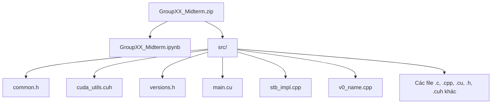
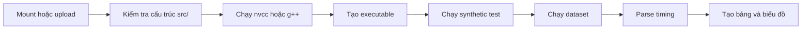
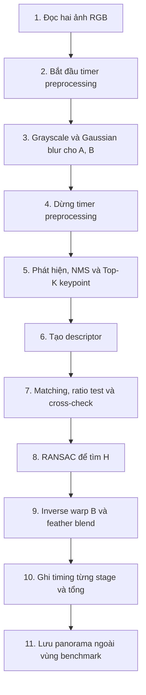

# Giải thích chi tiết yêu cầu giữa kỳ đồ án CSC14120

**Tài liệu nguồn:** `CSC14120_2026_Final Project_MidTerm.pdf` (3 trang).

Đây là bản diễn giải tiếng Việt kèm ví dụ và checklist. PDF gốc vẫn là đặc tả chính thức nếu có khác biệt.

## 1. Mục tiêu của mốc giữa kỳ

Bài giữa kỳ có tên **Proposal and Sequential Version**, hạn nộp vào **23:59 cuối tuần 7** và chiếm **10% điểm đồ án**. 90% còn lại thuộc bài cuối kỳ và bảo vệ miệng.

Mốc này nhằm xác nhận ba điều trước khi nhóm đầu tư vào CUDA:

1. nhóm hiểu bài toán ghép ảnh;
2. nhóm đã có pipeline tuần tự V0 chạy hoàn chỉnh và có số đo;
3. kế hoạch chuyển sang GPU dựa trên bottleneck thật, không phải phỏng đoán.

Nói ngắn gọn, giữa kỳ là “đóng cọc mốc chuẩn”. Nếu chưa có V0 đúng và được đo cẩn thận, về sau nhóm không thể chứng minh phiên bản CUDA đúng hơn hay nhanh hơn bao nhiêu.

## 2. Cấu trúc gói nộp

Chỉ một thành viên nộp một file ZIP qua website môn học:



Trong đó:

- `GroupXX` phải được thay bằng số nhóm thực tế.
- Notebook là báo cáo có giải thích, kết quả, bảng timing, biểu đồ và panorama; không cần nhét toàn bộ source code vào notebook.
- `src/` là **nguồn duy nhất của code**, chứa mọi file cần để build.
- Dataset không cần đặt trực tiếp trong ZIP theo cấu trúc trên; notebook phải cung cấp liên kết tới dataset của nhóm, chẳng hạn một file ZIP trên Google Drive gồm ảnh gốc và thư mục `dataset/` đã chuẩn bị.

### Vì sao không nên chép nguyên code vào notebook?

Nếu notebook có bản A còn `src/` có bản B, người chấm không biết kết quả được tạo từ bản nào. Yêu cầu “one source of truth” buộc notebook biên dịch trực tiếp từ `src/`, giúp code nộp và code tạo kết quả là cùng một bản.

Chỉ nên trích các đoạn ngắn để giải thích thiết kế, ví dụ vòng lặp matching, công thức homography hoặc cách đo thời gian.

## 3. Yêu cầu ghi tác giả và nguồn trong code

Ở đầu **mọi file nhóm viết hoặc sửa**, phải có comment liệt kê:

- tác giả;
- nguồn bên ngoài mà file được phỏng theo, nếu có.

Ví dụ:

```cpp
// Authors: Nguyen Van A (MSSV ...), Tran Thi B (MSSV ...)
// Adapted from: <ten du an/bai viet va URL>, accessed YYYY-MM-DD
// Changes: integrated into the six-stage V0 pipeline and added timing hooks.
```

Nếu tự viết hoàn toàn, có thể ghi rõ `External source: none`. Nếu dùng ý tưởng hoặc code ngoài, cần trích dẫn cả trong file nguồn và notebook.

## 4. Nội dung bắt buộc trong notebook

### 4.1 Thông tin nhóm và kế hoạch công việc

Notebook cần có tên, MSSV và bảng phân công từ hiện tại đến bài cuối kỳ. Bảng phải gắn người với stage và version cụ thể.

Ví dụ:

| Thành viên | Giữa kỳ | V1 CUDA | V2/V3 tối ưu | Kiểm chứng/báo cáo |
|---|---|---|---|---|
| A | preprocessing, detector V0 | kernel grayscale/blur/detector | shared-memory blur | unit test và timing |
| B | descriptor, matching V0 | descriptor/matching CUDA | tiled Hamming | biểu đồ hiệu năng |
| C | homography, warp/blend V0 | RANSAC, warp CUDA | stream/texture | dataset và gallery |

Bảng này là ví dụ về mức độ cụ thể, không phải cách chia bắt buộc. Nhóm vẫn phải bảo đảm mọi thành viên hiểu toàn bộ hệ thống để bảo vệ.

### 4.2 Hiểu bài toán

Nhóm phải giải thích pipeline bằng lời của mình, không chỉ chép đặc tả. Pipeline gồm:


Một cách giải thích dễ hiểu:

- Tiền xử lý làm ảnh ổn định hơn trước nhiễu.
- Detector tìm các mốc dễ nhận diện như góc cửa sổ.
- Descriptor tạo “chữ ký” quanh từng mốc.
- Matching ghép các chữ ký tương ứng giữa hai ảnh.
- RANSAC/homography tìm phép biến đổi hình học và loại match sai.
- Warping đưa ảnh phải sang hệ tọa độ ảnh trái; blending làm vùng nối tự nhiên hơn.

Phần này nên cho thấy nhóm hiểu quan hệ nhân quả: match sai làm homography sai; homography sai tạo bóng đôi; blending không thể sửa một alignment sai nặng.

### 4.3 Phương pháp đã chọn

Đối với từng stage, cần ghi:

1. thuật toán cụ thể;
2. tham số chính;
3. lý do về chất lượng;
4. lý do phù hợp hoặc không phù hợp với GPU.

Ví dụ về bảng lựa chọn:

| Stage | Lựa chọn minh họa | Tham số cần công bố | Lý do cần phân tích |
|---|---|---|---|
| Preprocessing | grayscale + Gaussian separable | sigma, kernel size | giảm nhiễu; stencil song song tốt |
| Detection | Harris + NMS + Top-K | ngưỡng, cửa sổ NMS, K | góc ổn định; score theo pixel |
| Description | BRIEF 256-bit | pattern, patch size | gọn, Hamming nhanh |
| Matching | brute-force + ratio + cross-check | ratio threshold | dễ song song hóa all-pairs; lọc mơ hồ |
| Homography | RANSAC 4-point DLT | iterations, reprojection threshold, seed | chống outlier; giả thuyết độc lập |
| Warp/blend | inverse bilinear + feathering | border mode, blend width | ảnh mượt; mỗi output pixel có thể xử lý độc lập |

Đây chỉ là một tổ hợp tham khảo. Nhóm được chọn tổ hợp khác nhưng phải nhất quán về phương pháp và tham số giữa các phiên bản để so sánh công bằng.

### 4.4 Phiên bản tuần tự V0

V0 phải:

- viết bằng C/C++;
- chạy **đầy đủ sáu stage**;
- tuân theo interface trong starter notebook;
- chạy đơn luồng;
- không dùng OpenMP;
- không dùng `std::thread`;
- không dùng SIMD tự viết.

Lý do cấm đa luồng và SIMD tự viết là V0 phải là baseline tuần tự công bằng. Nếu V0 đã dùng song song CPU mạnh nhưng được gọi là “sequential”, speedup của CUDA sẽ bị diễn giải sai.

V0 có thể do nhóm tự viết hoặc phỏng theo mã nguồn mở. Mọi phần tái sử dụng phải được trích dẫn trong source file và notebook.

### 4.5 Kết quả và profiling V0

Đây là phần trọng tâm của mốc giữa kỳ.

#### a. Correctness trên cặp synthetic

Phải báo **sai số homography** so với ground truth của cặp ảnh synthetic.

Một cách kiểm tra dễ hiểu là lấy các điểm chuẩn, biến đổi bằng homography ước lượng và homography thật, rồi đo khoảng cách trung bình:

```text
error_i = || project(H_est, p_i) - project(H_gt, p_i) ||_2
mean_error = sum(error_i) / n
```

Metric chính xác phải theo starter notebook hoặc quy ước được cung cấp. Không nên tự đổi metric mà không giải thích. Khi báo số, cần ghi đơn vị, thường là pixel, và ngưỡng được xem là chấp nhận được.

#### b. Panorama của dataset nhóm

Phải có một panorama đầu ra cho **mỗi địa điểm**, tức ít nhất ba kết quả từ ba site đã đăng ký. Nên hiển thị ảnh trái, ảnh phải và panorama để người đọc tự đánh giá.

#### c. Timing theo stage và độ phân giải

Phải có bảng thời gian từng stage ở small, medium và large.

Mẫu bảng:

| Resolution | Preprocess | Detect | Describe | Match | Homography | Warp+blend | Total |
|---|---:|---:|---:|---:|---:|---:|---:|
| 1280x720 | ... | ... | ... | ... | ... | ... | ... |
| 1920x1080 | ... | ... | ... | ... | ... | ... | ... |
| 3840x2160 | ... | ... | ... | ... | ... | ... | ... |

Mọi số trong bảng phải được sinh từ output cell, không gõ tay. Cần giữ cùng điều kiện chạy để so sánh độ phân giải.

#### d. Hot stages

Nhóm phải chỉ ra stage nào tốn thời gian nhất và bottleneck thay đổi thế nào khi tăng độ phân giải.

Ví dụ phân tích:

- Warp có độ phức tạp gần theo số pixel, nên thời gian có thể tăng xấp xỉ cùng tỷ lệ diện tích ảnh.
- Matching phụ thuộc vào số keypoint hai ảnh, gần `N x M`, không nhất thiết tăng đúng 4 lần khi chiều rộng và chiều cao cùng tăng 2 lần.
- Nếu dùng Top-K cố định, số match có thể bị chặn dù ảnh lớn hơn; khi đó các stage theo pixel tăng mạnh hơn matching.

Đừng chỉ viết “matching chậm nhất”; nên báo tỷ lệ phần trăm và giải thích nguyên nhân thuật toán/dữ liệu.

#### e. Ước lượng định luật Amdahl

Nếu các stage dự định tăng tốc chiếm tỷ lệ `p` trong thời gian V0, speedup end-to-end không thể vượt quá:

```text
S_max = 1 / (1 - p)
```

Đây là giới hạn khi giả sử phần được tăng tốc nhanh vô hạn. Ví dụ:

- tổng V0: 1000 ms;
- các stage định chuyển/tối ưu: 900 ms;
- `p = 900/1000 = 0.9`;
- `S_max = 1/(1-0.9) = 10x`.

Dù GPU làm 900 ms kia thành 0 ms, 100 ms phần còn lại vẫn tồn tại. Vì vậy không thể vượt 10x theo mô hình này.

Ví dụ thứ hai: nếu nhóm chỉ tăng tốc matching chiếm 40% tổng thời gian, `p = 0.4`, giới hạn chỉ là:

```text
S_max = 1 / 0.6 = 1.67x
```

Điều này giúp nhóm nhận ra tối ưu một kernel “rất nhanh” chưa chắc làm toàn chương trình nhanh tương ứng.

### 4.6 Dataset

Notebook phải thể hiện:

- ba địa điểm đã đăng ký;
- ít nhất một cặp chuẩn ở mỗi địa điểm;
- ít nhất một cặp khó;
- liên kết tới ảnh gốc và thư mục dataset đã chuẩn bị;
- tuân thủ phần Dataset của đặc tả cuối kỳ.

Đặc tả cuối kỳ còn yêu cầu mỗi cặp được chuẩn bị ở 1280x720, 1920x1080 và 3840x2160, cùng tỷ lệ 16:9, và ảnh nên overlap 30-50%. Nhóm nên kiểm tra ngay ở giữa kỳ để tránh phải chụp/làm dataset lại.

### 4.7 Kế hoạch GPU

Kế hoạch không được tách rời profiling V0. Với mỗi stage dự định đưa lên GPU, cần trả lời:

1. Vì sao chọn stage này? Nó chiếm bao nhiêu thời gian?
2. Ở V1, một thread, warp hoặc block sẽ tính gì?
3. Dữ liệu đầu vào/đầu ra là gì?
4. Rủi ro chính là gì?
5. Hai hoặc ba tối ưu dự kiến cho các phiên bản sau là gì?

Ví dụ:

| Stage | Bằng chứng V0 | Mapping V1 minh họa | Tối ưu sau V1 | Rủi ro |
|---|---|---|---|---|
| Gaussian blur | 24% total ở large | 1 thread/output pixel | separable + shared tile | halo, bank conflict, occupancy |
| Matching | 46% total | 1 thread/keypoint A, quét B | tile B + `__popc`, nhiều thread/keypoint | mất cân bằng, register pressure |
| RANSAC | 8% total | 1 warp/hypothesis | warp reduction, early stop | suy biến, random seed, atomic best |
| Warp | 17% total | 1 thread/output pixel | texture bilinear | truy cập không coalesced, xử lý biên |

Các con số trong bảng ví dụ là giả định, không được dùng thay số đo thật.

## 5. Yêu cầu tái lập

Notebook phải chạy từ đầu tới cuối bằng **Runtime -> Run all** trên một phiên Colab mới, sau khi `src/` có mặt.

### 5.1 Một nguồn code duy nhất

Cell setup phải đưa thư mục `src/` được nộp vào phiên Colab, bằng upload hoặc từ Drive, rồi compile chính thư mục đó.

Ví dụ luồng hợp lý:



Không nên có cell kiểu `%%writefile v0.cpp` chứa một bản source độc lập, vì nó tạo bản sao thứ hai không còn đồng bộ với file trong ZIP.

### 5.2 Mọi số liệu phải từ output

Nếu phần văn bản nói “matching mất 43.2 ms”, output cell phải thực sự sinh ra 43.2 ms. Cách an toàn là lưu kết quả có cấu trúc (CSV/JSON hoặc stdout dễ parse), để notebook tự tạo bảng và biểu đồ.

Điều này ngăn ba lỗi:

- số cũ còn lại sau khi code đã đổi;
- gõ nhầm số;
- chọn thủ công kết quả đẹp thay vì quy trình đo nhất quán.

## 6. Ví dụ về một V0 đủ sức làm baseline

Đây là luồng minh họa, không thay thế interface của starter notebook:



Tại giữa kỳ, dù chưa có CUDA kernel thật, các header/interface CUDA do starter cung cấp vẫn phải được tổ chức đúng để về sau thêm V1 mà không phá giao diện chương trình.

## 7. Cách phân tích kết quả thay vì chỉ liệt kê số

Một đoạn phân tích tốt có thể theo mẫu:

1. **Quan sát:** matching chiếm 52% V0 ở medium và 61% ở large.
2. **Giải thích:** số keypoint tăng làm số cặp so sánh gần tích `N x M`.
3. **Hệ quả:** matching là ưu tiên cao cho V1.
4. **Mapping:** phân phối keypoint A cho thread/warp, so sánh song song với tile descriptor B.
5. **Rủi ro:** đọc descriptor B lặp lại, register pressure và reduction tìm top-2.
6. **Tối ưu dự kiến:** shared-memory tiling và `__popc`.

Ngược lại, câu “matching chậm nên đưa lên GPU” chưa đủ vì không có số đo, không có tỷ lệ và không nêu cách song song hóa.

## 8. Các lỗi dễ mất điểm

- V0 chưa chạy đủ sáu stage.
- V0 dùng OpenMP, `std::thread` hoặc SIMD tự viết.
- Notebook dùng code viết lại trong cell, khác với `src/`.
- Thiếu comment tác giả/nguồn ở đầu file đã viết hoặc sửa.
- Dùng code ngoài nhưng chỉ ghi nguồn trong notebook, không ghi trong source, hoặc ngược lại.
- Chỉ có total time, không có timing từng stage ở ba độ phân giải.
- Không kiểm tra homography với ground truth synthetic.
- Thiếu panorama của một trong ba site.
- Tính Amdahl bằng cảm tính thay vì `p` lấy từ timing V0.
- Kế hoạch GPU không dựa trên hot stages.
- Không nói rõ thread/warp/block làm gì.
- Notebook không chạy được trên phiên Colab mới.
- Số liệu trong phần viết được gõ tay và không xuất hiện trong output cell.
- Dataset link không truy cập được hoặc thiếu ảnh gốc/thư mục chuẩn bị.

## 9. Trình tự làm bài đề xuất

### Bước 1: chốt dataset sớm

Đăng ký site, chụp theo đúng cách, tạo ba kích thước và tổ chức tên file ổn định. Kiểm tra link bằng cửa sổ ẩn danh hoặc tài khoản khác nếu quy định chia sẻ cho phép.

### Bước 2: chốt pipeline và tham số

Viết bảng sáu stage, phương pháp, tham số, lý do chất lượng và khả năng GPU. Tránh thay thuật toán sau khi đã benchmark nếu không có kế hoạch đo lại.

### Bước 3: hoàn thiện V0

Ưu tiên đúng và dễ kiểm chứng. Gắn timer quanh từng stage ngay từ đầu, tách I/O ra khỏi timing.

### Bước 4: kiểm tra synthetic và ảnh thật

Định lượng homography error trên synthetic; xem panorama của ba site. Khi lỗi, kiểm tra lần lượt match, inlier và reprojection trước khi đổ lỗi cho blending.

### Bước 5: benchmark ba độ phân giải

Chạy cùng quy trình, thu dữ liệu tự động, tạo bảng và biểu đồ. Ghi rõ phần cứng và điều kiện chạy.

### Bước 6: tính hot stages và Amdahl

Từ timing thật, tính tỷ lệ từng stage, chọn `p` theo các stage dự kiến tăng tốc, rồi tính giới hạn.

### Bước 7: viết kế hoạch V1/V2/V3

Nêu mapping V1 cho từng stage chọn; chọn hai hoặc ba tối ưu phù hợp bottleneck và nêu rủi ro.

### Bước 8: kiểm tra tái lập

Restart runtime, chạy `Run all`, kiểm tra source trong ZIP, output, panorama, bảng và biểu đồ. Không coi notebook chạy được trên phiên hiện tại là bằng chứng đủ, vì phiên hiện tại có thể chứa file/biến từ trước.

## 10. Checklist trước khi nộp

### File và cấu trúc

- [ ] Tên ZIP là `GroupXX_Midterm.zip` đúng số nhóm.
- [ ] ZIP chỉ có notebook và thư mục `src/` theo cấu trúc yêu cầu.
- [ ] `src/` chứa đủ file để build.
- [ ] Mọi file viết/sửa có comment tác giả và nguồn.
- [ ] Notebook có link dataset truy cập được.

### Notebook

- [ ] Có tên, MSSV và bảng kế hoạch công việc.
- [ ] Giải thích pipeline bằng lời của nhóm.
- [ ] Ghi phương pháp, tham số, lý do chất lượng và GPU cho sáu stage.
- [ ] V0 đơn luồng, đầy đủ pipeline, không OpenMP/thread/SIMD tự viết.
- [ ] Có homography error so với ground truth synthetic.
- [ ] Có panorama cho cả ba site.
- [ ] Có timing từng stage ở small, medium, large.
- [ ] Xác định hot stages và sự thay đổi theo resolution.
- [ ] Tính `p` và giới hạn Amdahl `1/(1-p)`.
- [ ] Kế hoạch GPU dựa trên profiling, có mapping và 2-3 tối ưu dự kiến.
- [ ] Nêu rủi ro kỹ thuật.

### Tái lập và trung thực

- [ ] Notebook build trực tiếp từ `src/` nộp kèm.
- [ ] Chạy được `Runtime -> Run all` trên phiên Colab mới.
- [ ] Mọi số trong phần viết đến từ output cell.
- [ ] Tất cả output đã được lưu trong notebook.
- [ ] Code/ý tưởng bên ngoài được trích dẫn đúng nơi.
- [ ] Kết quả là kết quả thật của code được nộp.

## 11. Mối liên hệ với bài cuối kỳ

Giữa kỳ không phải một sản phẩm tách rời. Các đầu ra nên được tái sử dụng trực tiếp:

| Giữa kỳ | Vai trò trong cuối kỳ |
|---|---|
| V0 đúng | Chuẩn kiểm chứng V1/V2/V3 |
| Per-stage timing | Bằng chứng chọn bottleneck đầu tiên |
| Dataset ba độ phân giải | Benchmark speedup xuyên suốt |
| Amdahl estimate | Kỳ vọng thực tế về end-to-end speedup |
| GPU mapping | Thiết kế V1 Basic CUDA |
| 2-3 ý tưởng tối ưu | Ứng viên cho V2/V3/V4 |
| Notebook tái lập | Khung báo cáo cuối kỳ |

Nếu hoàn thành mốc này đúng tinh thần, phần CUDA sau đó trở thành một chuỗi thí nghiệm có kiểm soát: mỗi phiên bản thay đổi có chủ đích, được kiểm chứng với V0 và được đánh giá bằng cùng dataset/cách đo.
