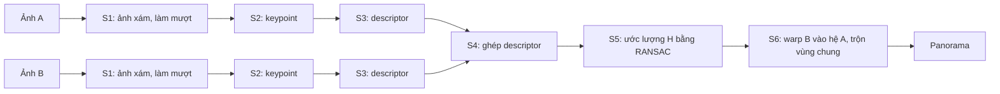

# 3.2 Hiểu bài toán

Người soạn: Tuấn (23120185). Cập nhật: 18/10. Nháp cho mục 3.2 của notebook giữa kỳ.

## Bài toán

Đầu vào là hai ảnh chụp cùng một cảnh, có một phần nội dung chung. Ta gọi ảnh trái là A, ảnh phải là B. Đầu ra là một ảnh panorama duy nhất chứa cả hai ảnh, trong đó vùng chung của A và B nằm chồng khít lên nhau.

Hai ảnh được chụp từ cùng một chỗ đứng, người chụp chỉ xoay máy. Khi tâm máy ảnh không dời đi, mọi điểm của ảnh B liên hệ với điểm tương ứng trong ảnh A qua một phép biến đổi phối cảnh (homography) H kích thước 3×3. Vì vậy bài toán ghép ảnh quy về việc tìm H rồi dùng H để đưa B vào hệ tọa độ của A. Nếu người chụp bước sang ngang, vật ở gần và vật ở xa dịch đi những khoảng khác nhau (parallax). Khi đó không có H nào khớp cho toàn ảnh và panorama sẽ bị lệch hoặc có ảnh kép. Đây là lý do đề yêu cầu "xoay máy, không bước đi" và chồng lấn khoảng 30–50%.

H có 8 bậc tự do, nên chỉ cần 4 cặp điểm tương ứng không có 3 điểm nào thẳng hàng là giải được. Khó khăn nằm ở chỗ chương trình phải tự tìm các cặp điểm đó trong hàng triệu pixel, và một phần các cặp tìm được sẽ sai.

## Pipeline sáu stage

1. Ở S1 (tiền xử lý), ảnh màu được đổi sang ảnh xám vì các bước sau chỉ cần độ sáng. Sau đó ảnh được làm mượt bằng bộ lọc Gaussian để bớt nhiễu. Nếu không làm mượt, nhiễu từng pixel dễ bị nhận nhầm là góc ở S2.
2. S2 tìm keypoint, tức những điểm dễ nhận ra lại trong ảnh kia, thường là góc, nơi độ sáng thay đổi theo nhiều hướng. Điểm trên vùng trơn hoặc dọc một cạnh thẳng thì không dùng được, vì có nhiều vị trí lân cận trông giống hệt nhau.
3. S3 gắn cho mỗi keypoint một descriptor, là một dãy số tóm tắt vùng ảnh nhỏ quanh nó. Hai keypoint nhìn cùng một chi tiết của cảnh sẽ có descriptor gần nhau.
4. S4 ghép cặp: với mỗi descriptor của A, chương trình tìm descriptor gần nhất trong B. Cặp nào mơ hồ, tức descriptor gần nhất và gần nhì trong B gần như bằng nhau, thì bị loại, vì vùng lặp lại như ô gạch hay cửa sổ dễ sinh ra cặp sai.
5. S5 ước lượng homography. Danh sách cặp sau S4 vẫn còn cặp sai, nên không thể giải H trực tiếp từ tất cả các cặp. RANSAC lặp lại nhiều lần: chọn ngẫu nhiên 4 cặp, giải ra một H, rồi xem bao nhiêu cặp khác khớp với H đó (inlier) và sai số của chúng lớn đến đâu. H có điểm tốt nhất được giữ lại và tính lại từ toàn bộ inlier của nó.
6. S6 warp và trộn ảnh. Từ H và kích thước hai ảnh, chương trình tính khung panorama đủ chứa cả A và B đã biến đổi. Với mỗi pixel của khung, chương trình tính ngược ra vị trí tương ứng trong A và trong B, lấy màu bằng nội suy, rồi trộn hai màu ở vùng chồng lấn.

S1 đến S3 chạy riêng trên từng ảnh và không phụ thuộc ảnh kia. S4 đến S6 cần dữ liệu của cả hai ảnh.

## Quy ước dữ liệu giữa các stage

| Ranh giới | Dữ liệu |
|---|---|
| Vào S1 | Ảnh RGB 8 bit, đọc bằng stb |
| S1 → S2, S3 | Ảnh xám `float` trong [0, 1] |
| S2 → S3 | Danh sách keypoint: tọa độ pixel, điểm số |
| S3 → S4 | Descriptor nhị phân 256 bit cho mỗi keypoint |
| S4 → S5 | Danh sách cặp chỉ số (keypoint A, keypoint B) kèm khoảng cách Hamming |
| S5 → S6 | Ma trận H 3×3 biến điểm của B thành điểm của A |
| Ra S6 | Ảnh RGB panorama và độ lệch gốc tọa độ của A trong panorama |

Chi tiết bố cục bộ nhớ và mã lỗi nằm trong `docs/interface.md`.

## Đánh giá kết quả

Một panorama được coi là tốt khi vùng chồng lấn khớp, không có cạnh bị đứt hay ảnh kép. Nhìn bằng mắt là chưa đủ để so sánh, nên Nhóm còn dùng một cặp ảnh synthetic: lấy một ảnh thật làm cảnh, tự tạo ảnh B từ ảnh A bằng một H biết trước, chạy pipeline rồi so H tìm được với H thật. Sai số được đo bằng khoảng cách (pixel) giữa vị trí mà hai ma trận chiếu cùng một lưới điểm của B vào A.

Về thời gian, đề yêu cầu đo riêng từng stage ở ba kích thước 1280×720, 1920×1080 và 3840×2160. Từ đó Nhóm xác định stage nào tốn thời gian nhất và ước lượng speedup tối đa theo định luật Amdahl trước khi chuyển sang CUDA.
