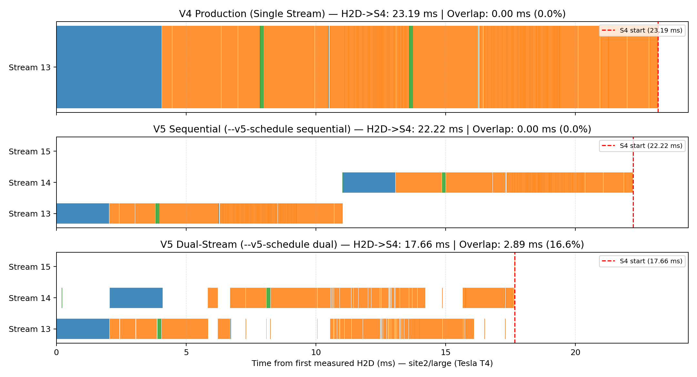

<!-- Authors: Le Thuong De (23120232). External source: none. -->

# P10-T05 — Benchmark chính thức V5 hai CUDA Stream, Profiling NSYS và quyết định APOD

Người thực hiện: **Lê Thượng Đế (23120232)**. Đo và kiểm chứng chính thức ngày **23/11/2026** trên Google Colab GPU **NVIDIA Tesla T4 (`sm_75`)** qua notebook [Group16_P10_T05_Benchmark_Profiling.ipynb](../../experiments/Group16_P10_T05_Benchmark_Profiling.ipynb).

## 1. Assess (Đánh giá điểm nghẽn)

Sau khi tối ưu hóa S5 (V2, V3) và S6 (V4), toàn bộ pipeline trước S4 (`H2D + S1–S3` của hai ảnh A và B) vẫn thực thi tuần tự trên một CUDA stream duy nhất: ảnh A được truyền và xử lý xong hoàn toàn rồi mới đến ảnh B.

Báo cáo baseline [P10-T01](p10-t01-pres4-baseline.md) ghi nhận đoạn pre-S4 chiếm tỷ trọng đáng kể ở độ phân giải `large`:
- `site1/large`: 13,086 ms (12,23% Total V4).
- `site2/large` (ca chính): 15,288 ms (21,44% Total V4).
- `site3/large`: 11,234 ms (11,20% Total V4).

Vì hai ảnh đầu vào A và B độc lập dữ liệu trước S4, tách H2D và S1–S3 lên hai CUDA stream không chặn (`streamA`, `streamB`) là thử nghiệm cuối cùng theo trục Thực thi và Đồng thời (*Execution & Concurrency Optimization*).

## 2. Parallelize & Optimize (Ý tưởng và Cài đặt)

- Tách luồng xử lý trước S4 thành hai nhánh độc lập trên hai non-blocking CUDA streams (`streamA`, `streamB`) với vùng `scratch`, `DeviceCounts` và `PinnedBuffer<uint32_t>` nhận candidate count riêng cho mỗi nhánh.
- Nạp sẵn bảng mẫu BRIEF và trọng số Gaussian trước khi tách nhánh để tránh đồng bộ ngầm.
- Điều phối theo mô hình **Prefix / Suffix**: Host phát prefix (H2D, S1, S2 candidates) cho cả hai nhánh, thăm dò sự kiện hoàn tất `cudaEventQuery` kèm `std::this_thread::yield()`, nhánh nào sẵn sàng trước được phát ngay suffix (S2 top-K, S3 BRIEF). Control stream chờ `doneA` và `doneB` bằng `cudaStreamWaitEvent`, hợp nhất counts rồi chạy hạ lưu S4–S6.
- **Chế độ đối chứng (Ablation):** CLI hỗ trợ `--v5-schedule sequential` (chạy nối tiếp trên cùng workspace và API V5) và `--v5-schedule dual` (hai stream đồng thời), kèm `--v5-detail-csv` ghi 14 cột chi tiết (`PreS4_ms`, `Host_PreS4_ms`, `CountWait_A_ms`, `CountWait_B_ms`).

## 3. Kiểm chứng trước khi đo

- Trước khi đo benchmark, notebook đã chạy `scripts/verify/verify_v5_cli.py --require-t4` trên cùng binary `build/stitch` (`PASS`).
- Toàn bộ 6 cặp synthetic, 12 cấu hình ảnh thật và `compute-sanitizer` (0 lỗi, 0 byte rò rỉ) đã được nghiệm thu tại [P10-T04](p10-v5-verification.md) và đóng băng hồi quy tại [P11-T02](p11-t02-freeze-verification.md).
- Trên 12 cấu hình thực tế trong phiên P10-T05: 10 cấu hình thành công khớp trạng thái; `challenge/medium` và `challenge/large` trả mã lỗi `NumericalFailure` đồng nhất ở V0, V4, V5 Sequential và V5 Dual.

## 4. Benchmark Results (Cùng phiên Tesla T4, không bật profiler)

Mỗi cấu hình chạy **1 lượt warm-up + 5 lượt đo** trên cùng GPU Tesla T4, cùng binary (`dad64da9...`) và cùng 24 ảnh dataset (khớp SHA-256 `manifest.csv`). Thời gian báo theo trung bình `Total_ms` (đơn vị ms):

| Cấu hình | Độ phân giải | V0 CPU (ms) | V4 Production (ms) | V5 Sequential (ms) | V5 DualStream (ms) | Speedup V5 vs V0 | Speedup V5 vs V4 | Speedup Dual vs Seq |
|---|---|---:|---:|---:|---:|---:|---:|---:|
| site1 | small | 1372,184 | 51,310 | 32,713 | 32,419 | 42,33× | 1,583× | 1,009× |
| site1 | medium | 2030,850 | 31,235 | 30,847 | 29,931 | 67,85× | 1,044× | 1,031× |
| site1 | large | 5438,691 | 106,206 | 105,908 | 103,084 | 52,76× | 1,030× | 1,027× |
| site2 | small | 1329,670 | 21,155 | 21,359 | 20,929 | 63,53× | 1,011× | 1,021× |
| site2 | medium | 2174,393 | 27,840 | 30,866 | 26,782 | 81,19× | 1,040× | 1,153× |
| site2 | large | 6498,800 | 62,275 | 61,442 | 58,926 | 110,29× | 1,057× | 1,043× |
| site3 | small | 1042,439 | 50,542 | 54,535 | 53,880 | 19,35× | 0,938× | 1,012× |
| site3 | medium | 1491,572 | 55,846 | 55,819 | 55,597 | 26,83× | 1,004× | 1,004× |
| site3 | large | 4183,050 | 100,017 | 101,531 | 97,985 | 42,69× | 1,021× | 1,036× |
| challenge | small | 1151,090 | 112,920 | 112,993 | 111,982 | 10,28× | 1,008× | 1,009× |

**Tổng hợp trung bình nhân (9 cấu hình chuẩn):**
- **V5 Dual / V0:** **49,88×** (khoảng 19,35× – 110,29×; cao nhất tại `site2/large` đạt **110,29×**).
- **V5 Dual / V4:** **1,0686×** (lưu ý `site1/small` V4 xuất hiện xung tăng xung nhịp/nhiễu 51,310 ms làm kéo trung bình nhân lên).
- **V5 Dual / V5 Sequential (đối chứng thuần túy):** **1,0364×** (cô lập hoàn toàn tác động của chạy hai stream so với nối tiếp trên cùng workspace).
- **Đo lại ca nghi ngờ (`site3/small`):** Lượt chính ghi nhận V5/V4 = 0,938× (< 0,95). Khi đo lại độc lập 5 runs (`recheck_site3_small`), V4 đạt 51,177 ms (min 44,973 ms) và V5 Dual đạt 44,460 ms (min 43,950 ms) → **V5/V4 = 1,1511×**, xác nhận **không có ca chuẩn nào chậm thật sự quá 5%** (dao động ban đầu do trạng thái xung nhịp GPU Colab trên ca `small`).

### Đánh giá thời gian đoạn Pre-S4 từ sidecar CSV (`--v5-detail-csv`)

| Cấu hình | Độ phân giải | Pre-S4 Seq (ms) | Pre-S4 Dual (ms) | Speedup Pre-S4 | Host Pre-S4 Dual (ms) | CountWait A (ms) | CountWait B (ms) |
|---|---|---:|---:|---:|---:|---:|---:|
| site1 | small | 2,911 | 2,483 | 1,173× | 1,891 | 0,467 | 1,117 |
| site1 | medium | 4,567 | 3,624 | 1,260× | 2,659 | 1,064 | 1,795 |
| site1 | large | 12,728 | 9,648 | 1,319× | 7,331 | 4,138 | 6,272 |
| site2 | small | 2,749 | 2,222 | 1,237× | 1,784 | 0,466 | 1,062 |
| site2 | medium | 4,875 | 3,639 | 1,340× | 2,701 | 1,059 | 1,799 |
| site2 | large | 13,700 | 10,971 | 1,249× | 7,680 | 4,176 | 6,389 |
| site3 | small | 2,665 | 2,213 | 1,204× | 1,947 | 0,458 | 1,108 |
| site3 | medium | 3,712 | 3,130 | 1,186× | 2,698 | 0,938 | 1,833 |
| site3 | large | 11,657 | 8,607 | 1,354× | 6,691 | 4,057 | 6,091 |

- **Trung bình nhân speedup Pre-S4 trên 9 ca chuẩn:** **1,2565×** (1,173× – 1,354×).
- Tại ca chính **`site2/large`**, Pre-S4 giảm từ **13,700 ms** xuống **10,971 ms** (**1,249×**, tiết kiệm **2,729 ms**).

### Kiểm tra độ ổn định: 5 khối đo ghép cặp luân phiên trên ca chính `site2/large`

| Khối | Thứ tự chạy | V4 Total (ms) | V5 Dual Total (ms) | V5 Dual Pre-S4 (ms) | Speedup V5/V4 |
|---:|---|---:|---:|---:|---:|
| 1 | `v4 → v5_dual` | 64,010 | 67,866 | 12,431 | 0,9432× |
| 2 | `v5_dual → v4` | 66,819 | 62,645 | 11,750 | 1,0666× |
| 3 | `v4 → v5_dual` | 71,491 | 64,635 | 12,087 | 1,1061× |
| 4 | `v5_dual → v4` | 65,495 | 70,533 | 12,754 | 0,9286× |
| 5 | `v4 → v5_dual` | 73,120 | 61,743 | 11,442 | 1,1843× |

- **Median speedup V5/V4:** **1,0666×** (khoảng **0,9286× – 1,1843×**).
- **Số khối có lợi cho V5:** **3/5 khối** (chưa đạt ngưỡng nhất quán **≥ 4/5 khối** theo tiêu chí chốt V5).

## 5. Nsight Systems Profiling, Overlap & Peak VRAM

Thu tách biệt **9 trace NSYS** (`nsys profile --trace=cuda,nvtx --cuda-memory-usage=true`, `--runs 1`, trích xuất từ `.sqlite` ở lượt đo thứ hai sau warm-up) cho V4, V5 Sequential và V5 Dual trên 3 ca `large`:

| Ca (`large`) | Chế độ | `H2D → S4 start` (ms) | Thời lượng chồng lấn (ms) | Tỷ lệ chồng lấn (%) | Số stream hoạt động trước S4 | Peak VRAM (MiB) | VRAM còn lại (B) |
|---|---|---:|---:|---:|---:|---:|---:|
| `site1/large` | V4 Prod | 13,444 | 0,000 | 0,0% | 1 | 238,37 | 0 |
| `site1/large` | V5 Seq | 15,439 | 0,000 | 0,0% | 3 | 302,67 | 0 |
| `site1/large` | **V5 Dual** | **10,836** | **2,176** | **20,6%** | 3 | 302,67 | 0 |
| `site2/large` | V4 Prod | 23,187 | 0,000 | 0,0% | 1 | 269,76 | 0 |
| `site2/large` | V5 Seq | 22,224 | 0,000 | 0,0% | 3 | 334,06 | 0 |
| `site2/large` | **V5 Dual** | **17,661** | **2,894** | **16,6%** | 3 | 334,06 | 0 |
| `site3/large` | V4 Prod | 11,730 | 0,000 | 0,0% | 1 | 243,50 | 0 |
| `site3/large` | V5 Seq | 11,913 | 0,000 | 0,0% | 3 | 307,80 | 0 |
| `site3/large` | **V5 Dual** | **8,858** | **2,046** | **24,5%** | 3 | 307,80 | 0 |

**Nhận xét kỹ thuật từ SQLite NSYS:**
1. **Xác nhận chồng lấn thực sự trên GPU:** V4 và V5 Sequential có mức chồng lấn đúng **0,0%**, trong khi V5 Dual đạt chồng lấn thực tế **2,046 – 2,894 ms (16,6% – 24,5%)**, giúp rút ngắn khoảng thời gian `H2D → S4 start` xuống còn 10,836 ms (`site1/large`), 17,661 ms (`site2/large`) và 8,858 ms (`site3/large`).
2. **Giới hạn chồng lấn trên Tesla T4:** H2D chồng lấn tốt với S1 nhờ Copy Engine độc lập của T4, nhưng khi hai nhánh cùng chạy các kernel S2/S3 chiếm occupancy cao trên **40 SM** của Tesla T4, phần tính toán vẫn phải chia sẻ SM thay vì song song hoàn toàn 100%.
3. **Chi phí bộ nhớ Peak VRAM:** V5 dùng thêm đúng **+64,30 MiB** VRAM so với V4 trên cả 3 ca `large` (tối đa **334,06 MiB** trên 15.360 MiB của T4 — hoàn toàn an toàn), và toàn bộ 9 trace ghi nhận `remaining_vram_bytes = 0` (không rò rỉ bộ nhớ).

## 6. Quyết định APOD (APOD Conclusion)

Đối chiếu từng tiêu chí đánh giá V5 trong [docs/task-board.md](../task-board.md):
- **Correctness & memcheck:** **ĐẠT** (P10-T04 & P11-T02: 0 px drift, Max RGB = 0, memcheck 0 lỗi, 0 byte rò rỉ).
- **NSYS có overlap & giảm thời gian đến S4:** **ĐẠT** (chồng lấn 16,6% – 24,5%; Pre-S4 nhanh hơn **1,2565×** GM, riêng `site2/large` giảm 13,700 → 10,971 ms).
- **Không có ca chuẩn nào chậm quá 5%:** **ĐẠT** (sau khi đo lại `site3/small` đạt 1,1511×).
- **Median speedup ≥ 1,05× tại `site2/large`:** **ĐẠT** (median 5 khối = **1,0666×**).
- **Tính nhất quán ≥ 4/5 khối cùng chiều:** **KHÔNG ĐẠT** (chỉ đạt **3/5 khối**, 2 khối còn lại dao động xuống 0,9286× và 0,9432× do nhiễu môi trường dùng chung của T4 và tranh chấp tài nguyên SM; đối chứng thuần túy `V5_dual / V5_seq` toàn bảng đạt GM **1,0364×**).

**Kết luận cho bài nộp cuối kỳ:**
- Nhóm giữ **V4 (Single-pass Canvas Fusion)** làm **phiên bản sản phẩm (Production Baseline)** chính thức nhờ tính ổn định cao và tiêu thụ VRAM thấp hơn 64,30 MiB.
- Nhóm giữ nguyên **V5 (Dual-stream Pipeline)** trong mã nguồn và báo cáo như một **nghiên cứu chuyên sâu (Concurrency Case Study)** đã kiểm chứng đầy đủ bằng số đo sidecar Pre-S4, 5 khối luân phiên và 9 trace NSYS trên Tesla T4.

## 7. Reproducibility và bàn giao

- **Môi trường:** NVIDIA Tesla T4 (15360 MiB), Driver `580.82.07`, `nvcc 13.0.88` (`-arch=sm_75 -std=c++11 -O2 --fmad=false`), `nsys 2025.3.1.0`, Linux `6.6.159+`.
- **Thời điểm hoàn tất:** `2026-11-23T06:47:04Z`.
- **Commit SHA kiểm chứng:** `26c8f241e056a7cf5e0c5bb0d85f036d9eafd9e1`.
- **Binary `build/stitch` SHA-256:** `dad64da9afbc570d232708369c589836f02e2178c60656e6ab8294038e1599e9`.
- **Dataset `manifest.csv` SHA-256:** `99fc712988075326a351d0bf580405e418bb28d24d56d4cc1b31505c480bdd9d` (24/24 ảnh khớp).
- **Gói bằng chứng:** `results/Group16_P10_T05_Evidence.zip` (SHA-256 `e80a7e9ed2932139a13271264a631c9ba3e2171a36b6e6cf20528e614f41ade7`) chứa đầy đủ CSV thô, sidecar 14 cột, 5 khối luân phiên, 9 trace `.nsys-rep`/`.sqlite`, `nsys_v5_analysis.json`, 3 biểu đồ và log lệnh.
