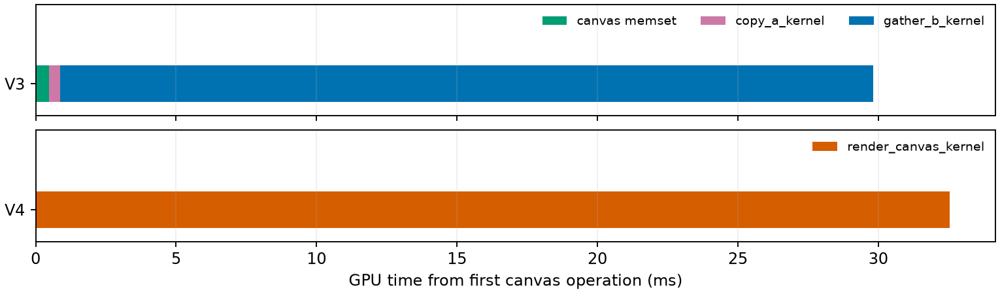
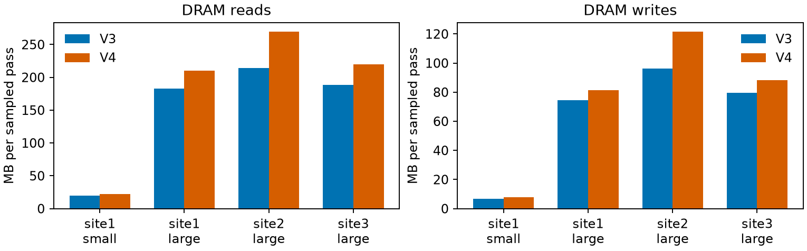

<!-- Authors: Le Thuong De (23120232). AI assistance: Codex helped prepare the notebook, analyze artifacts and draft this report. -->

# P9-T05 — Benchmark V4 và profiling S6

Người thực hiện: Lê Thượng Đế (23120232). Đo ngày 19/11/2026 trên Google Colab Tesla T4.

## 1. Bottleneck

Báo cáo [P8-T03](p8-t03-v3-apod.md) xác định S6 tại site2/large mất 28,468 ms, chiếm 45,7% tổng thời gian V3 sau khi S5 giảm xuống 12,200 ms. Đây là căn cứ lịch sử chọn ca chính trước lượt đo P9. Các bảng V0–V4 dưới đây được đo lại cùng phiên P9; không ghép baseline lịch sử vào speedup mới.

## 2. Idea

Single-pass Canvas Fusion thay ba lượt xóa canvas, chép A và gather/blend B bằng một renderer. Giả thuyết: giảm truy cập canvas và số thao tác GPU sẽ rút ngắn S6. Số lượt ghi giảm ở mức source không tự chứng minh giảm DRAM: cache, truy cập nguồn và phép tính FP64 vẫn ảnh hưởng thời gian.

## 3. Implementation và kiểm chứng

[Kernel S6 V4](../../src/v4/s6/v4_warp_blend.cu) dùng block 32×8, mỗi thread sở hữu một pixel canvas, xác định vùng A/B, đọc A trực tiếp, nội suy B và ghi màu cuối cùng. Giữ thứ tự phép tính, snap/clamp và làm tròn; giữ phần setup canvas dùng chung. [Pipeline V4](../../src/v4/v4_pipeline.cu) tái sử dụng S1–S4 V1 và S5 V3.

[Notebook P9](../../Group16_P9_T05_Benchmark_Profiling.ipynb) ghim source `ba97ed780785135e9d20ce36aac852efc4ebc898`. `src/` và `scripts/build.py` khớp source nghiệm thu P9-T02 `ab8df98d7f15bb42d5e3306cf03a38311248b4a8` qua `git diff --exit-code`. [P9-T02](p9-v4-verification.md) đã kiểm 6 synthetic, 12 cấu hình thật, CLI/CSV/D2H và memcheck T4; 10 ca thành công có Max RGB = 0, 2 challenge medium/large giữ NumericalFailure tại S6. Timing nghiệm thu không được dùng trong bảng benchmark.

## 4. Result: benchmark không có profiler

Một warm-up và năm runs mỗi cấu hình; cùng binary, dataset, tham số/seed và runtime cho V0–V4. Đơn vị ms. `Total_ms` theo contract CLI là thời gian pipeline, không đồng nhất với tổng kernel và không gồm toàn bộ thao tác đọc/ghi file của tiến trình. CSV thô giữ đủ S1–S6, H2D, D2H và `Total_Kernel_ms`.

| Site | Size | V0 ms | V1 ms | V2 ms | V3 ms | V4 ms | V4/V0 | V4/V3 |
|---|---|---:|---:|---:|---:|---:|---:|---:|
| site1 | small | 1122.724 | 582.832 | 72.193 | 32.620 | 32.716 | 34.32× | 0.9971× |
| site1 | medium | 1607.505 | 516.439 | 54.436 | 31.027 | 30.785 | 52.22× | 1.0078× |
| site1 | large | 4769.980 | 413.098 | 258.412 | 108.107 | 107.157 | 44.51× | 1.0089× |
| site2 | small | 1134.956 | 934.590 | 24.924 | 21.415 | 21.142 | 53.68× | 1.0129× |
| site2 | medium | 1898.331 | 873.471 | 28.663 | 27.932 | 27.581 | 68.83× | 1.0127× |
| site2 | large | 5746.068 | 504.101 | 81.091 | 62.874 | 62.197 | 92.38× | 1.0109× |
| site3 | small | 757.071 | 366.485 | 112.089 | 44.846 | 44.576 | 16.98× | 1.0061× |
| site3 | medium | 1551.088 | 390.440 | 141.927 | 56.167 | 55.723 | 27.84× | 1.0080× |
| site3 | large | 3934.283 | 411.157 | 253.210 | 101.713 | 100.393 | 39.19× | 1.0131× |

V4/V3 trung bình nhân **1.0086×**, nhanh hơn ở 8/9 ca chuẩn. V4/V0 trung bình nhân **43.02×**, khoảng 16.98–92.38×. S6 trung bình nhân nhanh hơn **1.0357×**.

| Site | Size | S6 V3 ms | S6 V4 ms | Speedup S6 | S6 / V3 total | S6 / V4 total |
|---|---|---:|---:|---:|---:|---:|
| site1 | small | 2.301 | 2.221 | 1.0359× | 7.1% | 6.8% |
| site1 | medium | 5.075 | 4.772 | 1.0633× | 16.4% | 15.5% |
| site1 | large | 19.649 | 19.531 | 1.0061× | 18.2% | 18.2% |
| site2 | small | 3.408 | 3.287 | 1.0368× | 15.9% | 15.5% |
| site2 | medium | 7.305 | 6.961 | 1.0495× | 26.2% | 25.2% |
| site2 | large | 28.712 | 28.190 | 1.0185× | 45.7% | 45.3% |
| site3 | small | 2.791 | 2.738 | 1.0193× | 6.2% | 6.1% |
| site3 | medium | 5.872 | 5.645 | 1.0403× | 10.5% | 10.1% |
| site3 | large | 21.476 | 20.405 | 1.0525× | 21.1% | 20.3% |

CV `Total_ms` của V4 trên chín ca chuẩn là 0.26–1.20%. Site1/small giảm tốc khoảng 0.29% theo tỷ số speedup, và chênh lệch nhỏ giữa các stage không đổi cho thấy chưa có cơ sở quy toàn bộ khác biệt timing cho fusion.

Challenge/small chạy được nhưng có CV 6.94% ở V4. Challenge medium/large trả NumericalFailure ở cả năm phiên bản; không có timing để tính speedup. Trung bình nhân chỉ dùng chín ca chuẩn.

## 5. Analysis

Bảng đầu cho thấy lợi ích pipeline chỉ khoảng 0.86% theo tỷ số speedup. S6 V4 vẫn là hotspot tại site2/large; các ca còn lại chủ yếu vẫn bị S5 chi phối. Cần phân biệt giảm thời gian S6, giảm traffic được đo và cải thiện người dùng nhận được ở `Total_ms`.

### Độ ổn định tại ca chính

Sau profiling, chạy thêm năm khối V3/V4, mỗi bản một warm-up + năm runs; luân phiên thứ tự V3→V4 và V4→V3. Median speedup theo khối là **1,0270×**, min–max **0,9774–1,0409×**, bốn trong năm khối có lợi cho V4. Đây là một phép kiểm tra độ ổn định bổ sung, không thay thế bảng chín cấu hình ở trên. Khoảng kết quả chứa cả regression; không xem 2,7% là lợi ích được bảo đảm.

[Kế hoạch V4–V5 trước đây](v4-v5-optimization-plan.md) từng đề xuất mức tăng ít nhất 5% tại ca chính, kèm 4/5 khối cùng chiều. Kết quả hiện tại chưa đạt phần ngưỡng 5%; đây là ngưỡng đề xuất của kế hoạch đó, không phải tiêu chí bắt buộc của task board. P9 vẫn báo cáo đầy đủ ý tưởng và số đo, kể cả lợi ích nhỏ.

### Profiling S6

Đã thu đủ **8 trace NSYS và 12 report NCU** trên bốn cấu hình. Ca chính là `site2/large`, với canvas 7676×4348 và offset (0, 1038) ở cả V3 và V4. Hai công cụ dùng các lượt chạy riêng với benchmark ở mục 4.

**Nsight Systems.** Mỗi trace ghi một warm-up và một run. Trong từng lượt, V3 gọi một canvas memset, một `copy_a_kernel` và một `gather_b_kernel`. V4 thay ba thao tác đó bằng một `render_canvas_kernel`. Cả hai vẫn chạy `setup_kernel` và các thao tác khởi tạo buffer khác. Bảng cộng thời lượng GPU của các thao tác dựng canvas ở lượt thứ hai, lấy từ SQLite của trace. Phạm vi bảng chỉ gồm ba thao tác trên ở V3 và renderer ở V4.

| Ca | V3 clear (ms) | V3 copy A (ms) | V3 gather B (ms) | V3 tổng (ms) | V4 render (ms) |
|---|---:|---:|---:|---:|---:|
| site1/small | 0.029 | 0.055 | 5.195 | 5.279 | 4.627 |
| site1/large | 0.325 | 0.401 | 18.755 | 19.481 | 19.298 |
| site2/large | 0.474 | 0.381 | 28.950 | 29.804 | 32.541 |
| site3/large | 0.355 | 0.402 | 20.283 | 21.039 | 21.828 |

Ở `site2/large`, lượt xóa riêng 100.125.744 byte canvas biến mất, cùng khoảng 0,85 ms clear và copy A trong lượt trace thứ hai. Renderer hợp nhất lại mất 32,541 ms trong trace này, cao hơn tổng 29,804 ms của V3. `site3/large` cũng chậm hơn trong trace, dù benchmark năm run cho S6 nhanh hơn ở cả hai ca. Lấy benchmark ở mục 4 làm ước lượng hiệu năng và dùng trace để xác nhận chuỗi thao tác. Các số trong bảng được làm tròn độc lập.

**Nsight Compute.** Mỗi report lấy launch đầu khớp bộ lọc. Bảng dùng các counter `dram__bytes_read.sum` và `dram__bytes_write.sum` xuất trong `metrics.csv`, đơn vị MB thập phân. Cột V3 cộng hai mẫu riêng của copy A và gather B. Canvas memset nằm ngoài phạm vi counter này. Kích thước vùng memset trong NSYS mô tả byte logic được yêu cầu, nên không cộng vào lưu lượng DRAM do NCU đo.

| Ca | V3 đọc (MB) | V4 đọc (MB) | V3 ghi (MB) | V4 ghi (MB) | Đổi tổng đọc + ghi |
|---|---:|---:|---:|---:|---:|
| site1/small | 19.84 | 22.50 | 6.79 | 7.86 | +14.0% |
| site1/large | 182.65 | 210.49 | 74.42 | 81.55 | +13.6% |
| site2/large | 214.51 | 269.95 | 96.27 | 121.74 | +26.0% |
| site3/large | 188.83 | 219.62 | 79.70 | 88.43 | +14.7% |

Tại `site2/large`, renderer V4 dùng 38 thanh ghi/thread so với 36 của gather B, trong khi achieved occupancy lần lượt là 90,98% và 89,98%. Tỷ lệ hit L2 của renderer là 70,75%, thấp hơn 76,19% của gather B. Hai kernel đạt khoảng 85% thông lượng SM theo NCU, với DRAM throughput lần lượt là 1,67% và 0,90% mức đỉnh báo cáo. Các mẫu này phù hợp với việc đường truy cập bộ nhớ thay đổi khi fusion và DRAM chưa bão hòa. Chúng chưa đủ để định lượng mức đóng góp riêng của cache, FP64 hay chi phí launch vào chênh lệch timing.

**Kết luận APOD.** V4 đạt parity và giảm số thao tác dựng canvas. Benchmark cho S6 nhanh hơn trung bình nhân 1,0357× và pipeline nhanh hơn 1,0086×. Bằng chứng NCU chỉ ra lưu lượng đọc và ghi tăng trong phạm vi kernel quan sát. Tổng DRAM của cả S6 vẫn chưa xác định vì thiếu counter cho memset V3. Giữ V4 trong báo cáo như một thử nghiệm fusion đã nghiệm thu với lợi ích nhỏ. Ca chính đạt median 1,0270× qua năm khối, dưới ngưỡng 1,05× đề xuất trước đó.

## 6. Reproducibility và bàn giao

- GPU: Tesla T4, 580.82.07; CPU: Intel(R) Xeon(R) CPU @ 2.00GHz; Python 3.13.16; nvcc 13.0.88; build `sm_75 -O2 --fmad=false` qua script của repo.
- Thời điểm benchmark: `2026-11-19T11:26:42+00:00`.
- Source snapshot SHA-256: `ed228f119ba562e494761a187171a74aa190841bed5a72a69e4c9a584e5c4139`.
- Binary SHA-256: `a451e51a772dcb2020b7c534a70a397f289945561385636343bae5c582e3aa7d`.
- Dataset manifest SHA-256: `99fc712988075326a351d0bf580405e418bb28d24d56d4cc1b31505c480bdd9d`, kiểm hash đủ 24 ảnh.
- Gói gốc `Group16_P9_Evidence.zip` có SHA-256 `a16c610c7a8bff02c6cd61c94bacd79a9d1d0793b2c838d58d996ca3c6e060c7`. Trong gói, `v4/benchmark/` chứa CSV, biểu đồ và kết quả năm khối. `v4/profiling/` chứa 20 report gốc, SQLite, các bản xuất CSV và `profile_status.json`. Biểu đồ timeline và counter của báo cáo được dựng từ các bản xuất này. Gói bàn giao cũng có hai ảnh chụp giao diện của report V4 tại site2/large để đối chiếu. [NSYS](../../slides/generated/screenshots/nsys-v4-site2-large.png) · [NCU](../../slides/generated/screenshots/ncu-v4-site2-large.png).
- Bộ bàn giao cục bộ `results/Group16_P9_Handoff.zip` gồm benchmark, profiling, báo cáo, hình và slide. Đế phụ trách upload vào Drive nhóm.
